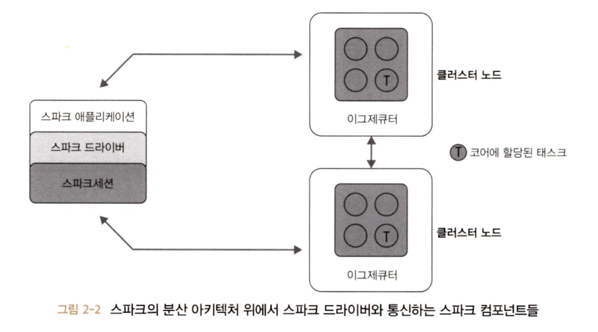
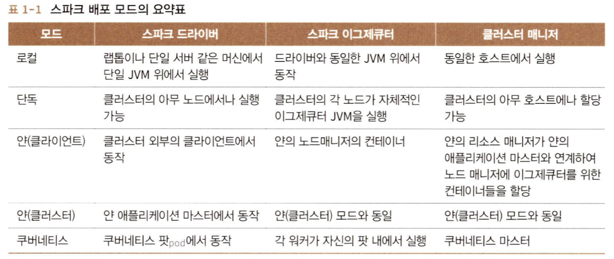
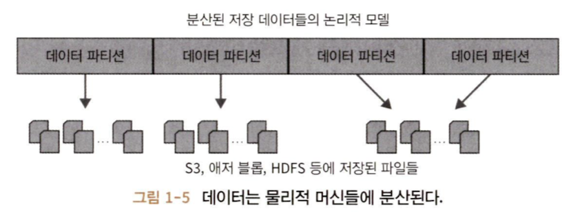
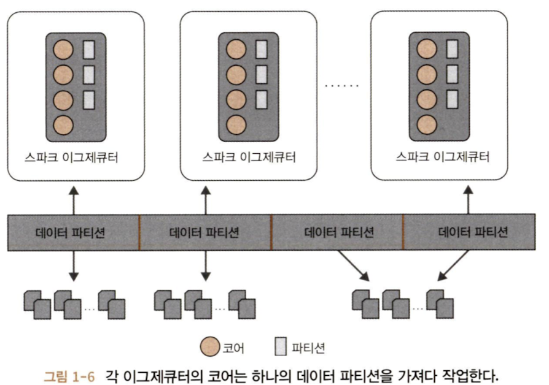

## 스파크의 시작

---

아파치 스파크가 어떻게 생겨났고, 어떤 것으로부터 영감을 받았는지, 그리고 어떻게 커뮤니티에서 실질적인 업계 표준인 빅데이터 통합처리 엔진으로 채택되었는지 그 과정을 살펴볼 것이다.

### 빅데이터와 구글에서의 분산 컴퓨팅

RDBMS 같은 전통적인 저장 시스템뿐만 아니라 어떤 프로그래밍 수단으로도 구글이 색인을 만들고 검색할 규모의 인터넷 문서를 다루는 것은 불가능했으며 새로운 접근 방식이 필요했다. 구글은 **구글 파일 시스템(GFS)**, **맵리듀스(MR)**, **빅테이블** 등을 만들어 내게 되었다. 

- GFS : 클러스터 안에서 사용 서버에 장애 내구성이 있는 분산 파일시스템을 제공
- 빅테이블 : GFS를 기반으로 구조화된 대규모 데이터의 저장 수단을 제공
- MR : 함수형 프로그래밍 개념을 기반으로 하여 GFS와 빅테이블 위에서 대규모 데이터 분산 처리가 가능한 새로운 병렬 프로그래밍의 패러다임

맵리듀스 애플리케이션은 데이터를 멥리듀스 시스템과 연계하여 데이터의 지역성과 랙의 근접성 등을 고려해 데이터가 존재하는 곳으로 연산 코드(맵 함수와 리듀스 함수)를 보내게 된다.

1. 클러스터의 워커 노드가 중간 연산을 통해 집계 
2. 합친 결과를 리듀스 함수에서 최종 결과 생산
3. 애플리케이션이 접근 가능한 분산 저장소에 기록

이 접근 방식이 네트워크 트래픽을 크게 감소시키면서 네트워크로 데이터를 분산시키는 것을 지양하고, 로컬 디스크에 대한 IO를 극대화한다.

  
### 야후!에서의 하둡

이러한 구글의 GFS 논문에 기술된 캄퓨팅 차원의 과제와 해결책은 하둡 파일 시스템(HDFS)과 분산 컴퓨팅 프레임워크로서의 맵리듀스 구현애 대한 청사진을 제공했다. 그리고 2006년 4월에 관련 모듈이 하둡 프레임워크의 일부가 되었다.

아파치 하둡은 야후! 외부에서도 광범위하게 적용되고 수많은 오픈소스에 영감을 주었지만 HDFS에서 돌아가는 맵리듀스 프레임워크에는 몇 가지 단점이 있었다.

1. 번거로운 운영 복잡도로 인해 관리가 쉽지 않았다.
2. 일반적인 배치 처리를 위한 맵리듀스 API는 장황하고 많은 양의 기본 셋업 코드를 필요로 했으며, 장애 대응은 불안정했다.
3. 방대한 배치 데이터 작업을 수행하면서 많은 MR 태스크가 필요해지면 각 태스크는 이후의 단계들을 위해 중간 과정의 데이터를 로컬 디스크에 써야 했다.
4. 하둡 MR은 일반적은 배치 처리를 위한 대규모 작업에는 적당하지만 머신러닝이나 스트리밍, 상호 반응하는 SQL 계통의 질의 등 다른 워크로드와 연계해 쓰기에는 한계가 있다.

### AMP 랩에서의 스파크 초창기

하둡 MR을 좀 더 간편하고 빠르게 만들기 위해서 **스파크(Spark)**라고 불리는 프로젝트를 진행했다. 이 프로젝트는 초기부터 스파크를 단순하고 빠르고 더 쉽게 만들어야 한다고 생각했으며 2009년 RAD 랩에서부터 시작되었으며, 나중에 AMP 랩이 되었다(지금은 RISE 랩으로 알려졌다).

## 아파치 스파크란 무엇인가?

---

아파치 스파크는 데이터 센터나 클라우드에서 대규모 분산 데이터 처리를 하기 위해 설계된 통합형 엔진이다.

스파크는 머신러닝, 대화형 질의를 위한 SQL(스파크 SQL), 실시간 데이터 처리를 위한 스트리밍 처리(스파크 스트리밍), 그래프 처리(GraphX) 등을 위해 쉽게 사용 가능한 API들로 이루어진 라이브러리를 갖고 있다.

스파크 설계 철학의 중심에는 네 개의 핵심 특성이 있다.

- 속도
- 사용 편리성
- 모듈성
- 확장성

### 속도

스파크는 다양한 방법으로 빠른 속도를 추구한다.

- 하드웨어 및 OS 발전(수백 GB 대용량 메모리, 다중 코어, 유닉스 기반 OS의 고성능 멀티스레딩 및 병렬 처리)을 활용한 시스템 최적화
- 질의 연산을 `방향성 비순환 그래프(DAG)`로 구성
  - DAG의 스케줄러와 질의 최적화 모듈은 효율적인 연산 그래프를 만들어서 각각의 태스크로 분해하여 클러스터의 워커 노드 위에서 병렬 수행될 수 있도록 하낟.
- 물리적 실행 엔진인 텅스텐은 전체적 코드 생성이라는 기법을 써서 실행을 위한 간결한 코드를 생성
- 모든 중간 결과를 메모리에 유지하며 디스크 I/O를 제한적으로 사용

### 사용 편리성

스파크는 데이터 프레임이나 데이터 세트 같은 고수준 데이터 추상화 계층 아래에 유연한 `분산 데이터세트(RDD)`라 불리는 핵심적이면서도 단순한 논리 자료구조를 구축하여 단순성을 실현하였다.

**연산**의 종류로서 **트랜스포메이션**과 **액션**의 집합과 단순한 프로그래밍 모델을 제공한다.


### 모듈성

스파크 연산은 다양한 타입의 워크로드에 적용 가능하며, 지원하는 모든 프로그래밍 언어로 표현할 수 있다.

- API들로 이루어진 통합 라이브러리
- 핵심 컴포넌트 : 스파크 SQL, 스파크 정형화 스트리밍, 스파크 MLlib, GraphX

하나의 엔진 안에서 연동된 상태로 사용할 수 있다.

또한, 하나의 스파크 애플리케이션을 작성함으로써 모든 것이 실행 가능해지며 전형 다른 작업을 위해 변도의 엔진과 API가 필요없다. 즉, 워크로드를 처리하기 위한 하나의 통합된 처리 엔진이다.

### 확장성

스파크는 저장보다는 빠른 병렬 연산 엔진에 초점이 맞추어져 있다. 저장과 연산을 모두 포함하는 아파치 하둡과 달리 스파크는 이 둘을 분리했기 때문에 수많은 데이터 소스(하둡, 카산드라, 몽고DB, RDBMS 등)에서 데이터를 읽어 들여 메모리에서 처리 가능하다.

스파크의 `DataFrameReader`나 `DataFrameWriter` 또한 더 많은 데이터 소스(카프카, 애저 저장소, AWS S3 등)에서 데이터를 읽어 들여서 논리적인 데이터 추상화 레벨에서 처리할 수 있도록 확장 가능하다.


## 통합된 분석

---

통합은 스파크에 있어서 설계 철학과 진화를 나타내는 핵심 개념이다. 스파크는 하나의 단일 분산 처리 엔진 위에서 다양한 워크로드를 처리할 수 있는 통합된 컴포넌트 스택이라는 것에 주목했다.


### 단일화된 스택으로의 아파치 컴포넌트

네 개의 다양한 워크로드를 위한 다음과 같은 라이브러리를 제공한다.

- 스파크 SQL
- 스파크 MLlib
- 스파크 정형화 스트리밍
- GraphX

이 각각의 컴포넌트는 스파크의 중심 장애 대응 엔진과는 별도로 존재하며, API를 써서 스파크 애플리케이션을 만들면 스파크 코어 엔진이 적절한 DAG로 변환해 실행하게 된다.

그러므로 어떤 언어로 스파크 코드를 작성해 정형화 API를 사용하더라도 실제 코드는 고도로 경량화된 바이트코드로 변환되어 클러스터 전체에 나뉘어 워커 노드의 JVM에서 실행된다.


#### 스파크 SQL

RDBMS 테이블이나 구조화된 데이터의 파일 포맷에서 데이터를 읽어 들일 수 있으며(CSV, 텍스트, JSON, Avro, ORC, Parquet 등), 그 데이터로 스파크에서 영구적이거나 임시적은 테이블을 만들 수 있다.

또한, 스파크 정형화 API를 사용하여 SQL 계통의 질의를 써서 데이터를 바로 데이터 프레임으로 읽어 들일 수 있다.

#### 스파크 MLlib

MLlib는 범용 머신러닝 알고리즘들을 포함한 라이브러리이다. 모델을 구축하기 위한 고수준 데이터 프레임 기반 API 기반으로 여러 인기 있는 머신러닝 알고리즘을 제공한다. 이 API들은 특성들을 추출하고 변형하고 파이프라인을 구축하고 배포하는 동안 모델을 보존해준다. 또한, 일반적인 선형대수 연산과 경사 하강법 최적화를 포함한 다른 저수준 ML 기능을 지원한다.

#### 스파크 정형화 스트리밍

스파크 구조적 스트리밍(Structured Streaming)의 핵심은 스트림을 연속적으로 증가하는 **끝이 없는 테이블(Unbounded Table)**로 취급한다는 점이다. 

아파치 카프카 등 다양한 데이터 소스에서 유입되는 스트리밍 데이터든 정적 데이터든 관계없이 스파크는 이를 테이블 끝에 끊임없이 추가되는 새로운 레코드로 바라본다. 덕분에 개발자들은 복잡한 스트리밍 로직을 고민할 필요 없이, 마치 일반적인 정적 정형 테이블(Structured Table)을 다루듯 쿼리만 날리면 된다.

정형화 스트리밍 모델의 하부에서는 강력한 **스파크 SQL 엔진**이 장애 복구(Fault-tolerance)와 지연 데이터(Late Data) 처리를 관리해주므로, 개발자들에게 쉽게 스트리밍 애플리케이션을 작성하도록 해준다.

#### GraphX

그래프를 조작하고 그래프 병렬 연산을 수행하기 위한 라이브러리다. 분석, 연결 탐색 등의 표준적인 그래프 알고리즘과 커뮤니티의 사용자들이 기여한 알고리즘을 포함하고 있다.

### 아파치 스파크의 분산 실행

스파크는 분산 데이터 처리 엔진이며 그 컴포넌트들이 클러스터의 머신들 위에서 협업해 동작한다. 

하나의 스파크 애플리케이션은 스파크 클러스터의 병렬 작업들을 조율하는 하나의 드리아버 프로그램으로 이루어진다. 드라이버는 `SparkSession` 객체를 통해 클러스터의 분산 컴포넌트들에 접근한다.

#### 스파크 드라이버

`SparkSession` 객체를 초기화하는 책임을 가진 스파크 애플리케이션의 일부로서, 스파크 드라이버는 여러 가지 역할을 한다.

- 클러스터 매니저와 통신하며 스파크 이그제큐터들응 위해 필요한 자원(CPU, 메모리 등)을 요청
- 모든 스파크 작업을 DAG 연산 형태로 변환하고 스케줄링하며 각 실행 단위를 태스크로 나누어 스파크 이그제큐터들에게 분배
- 자원이 할당된 경우부터 이그제큐터와 직접 통신



#### SparkSession

스파크 2.0에서 SparkSession은 모든 스파크 연산과 데이터에 대한 통합 연결 채널이 되었다. 즉, 모든 스파크 기능을 한 군데에서 접근할 수 있는 시작점을 제공한다.

- JVM 실행 파라미터들을 생성
- 데이터 프로엠이나 데이터세트를 정의
- 데이터 소스에서 데이터를 읽기
- 메타데이터에 접근하고 스파크 SQL 질의를 실행

#### 클러스터 매니저

스파크 애플리케이션이 실행되는 클러스터에서 자원을 관리 및 할당하는 책임을 지닌다. 현재 스파크는 네 종류의 클러스터 매니저를 지원한다.

- standalone cluster manager
- 아파치 하둡 얀
- 아파치 메소드
- 쿠버네티스

#### 스파크 이그제큐터

Spark executor는 각 클러스터의 각 워커 노드에서 동작한다. Executor는 드라이버 프로그램과 통신하며 워커에서 태스크를 실행하는 역할을 한다. 대부분의 배포 모드에서 노드당 하나의 이그제큐터만이 실행된다.

#### 배포 모드

스파크는 여러 다른 환경에서 다른 설정으로 돌아갈 수 있도록 다양한 배포 모드를 지원한다. 클러스터 매니저는 실행되는 환경에 대한 자세한 정보 없이도 돌아갈 수 있도록 추상화되어 있다.

스파크 배포 모드는 다음과 같다.



#### 분산 데이터와 파티션

물리적인 데이터는 HDFS나 클라우드 저장소 파티션으로 저장소 전체에 분산된다. 스파크는 각 파티션을 메모리의 데이터 프레임 객체로 본다. Spark executor는 가급적 데이터의 지역성을 고려하여 네트워크에서 가장 가까운 파티션을 읽어 들이도록 태스크를 할당한다.



**파티셔닝**은 효과적인 병렬 처리를 가능하게 해준다. 데이터를 청크나 파티션으로 분산해 저장하는 방식은 Spark executor가 네트워크 사용을 최소화하며 가까이 있는 데이터만 처리할 수 있도록 해준다. 

즉, 각 executor가 쓰는 CPU 코어는 작업해야 하는 데이터의 파티션에 할당하게 된다.



```python
# 클러스터에 나뉘어서 저장된 물리적 데이터들을 8개의 파티션으로 나누고,
# 각 executor가 하나 이상의 파티션을 메모리로 읽어들이는 코드
log_df = spark.read.text("path_to_large_text_file").repartition(8)
print(log_df.rdd.getNumPartitions())

# 1만 개의 정수로 구성된 데이터 프레임을 만들어서 8개의 파티션으로 메모리에 분산
df = spark.range(0, 10000, 1, 8)
print(df.rdd.getNumPartitions())
```

