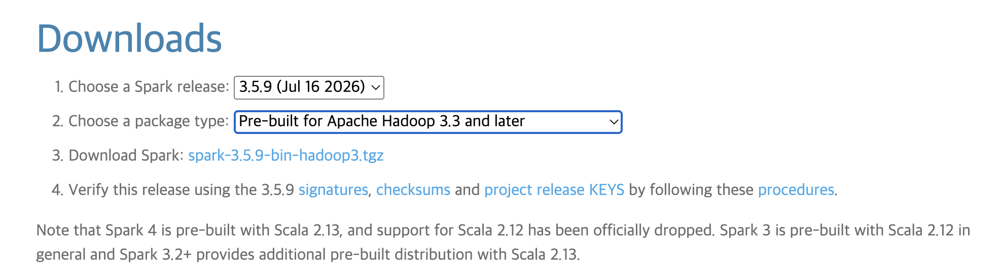
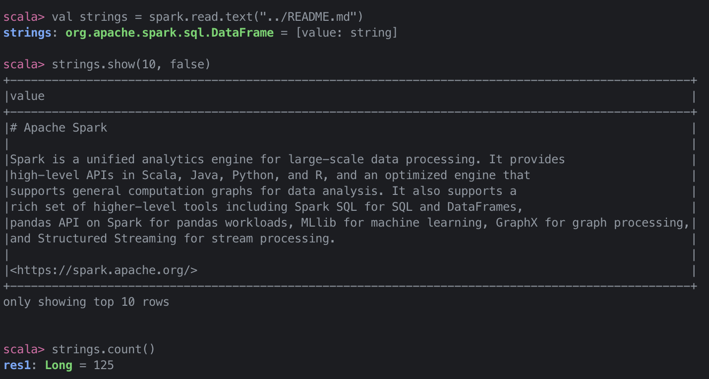
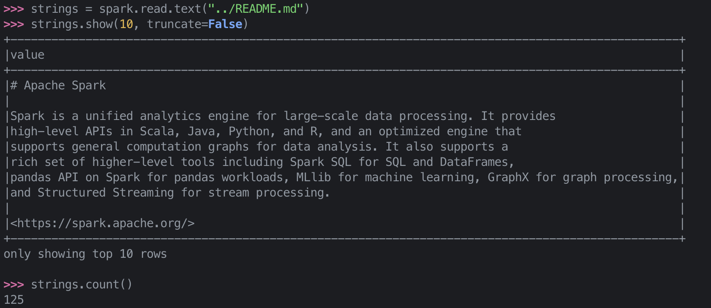
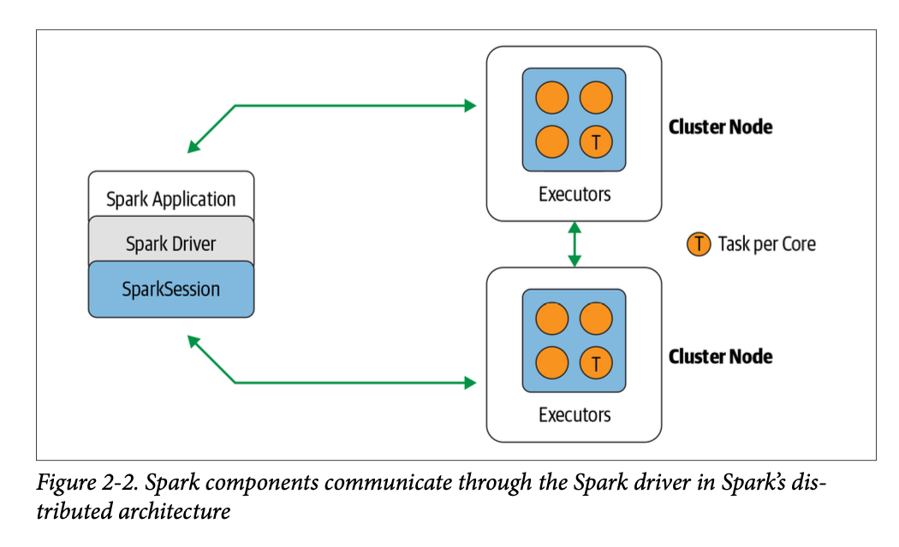
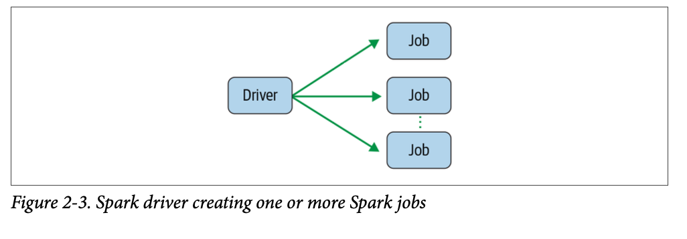
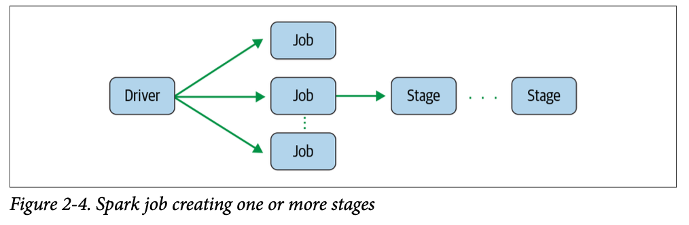
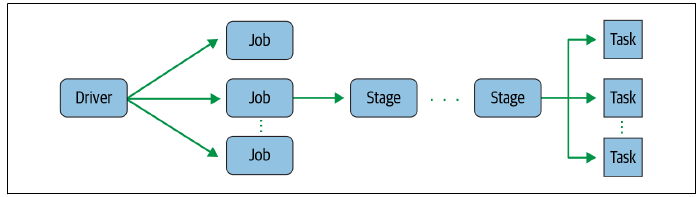
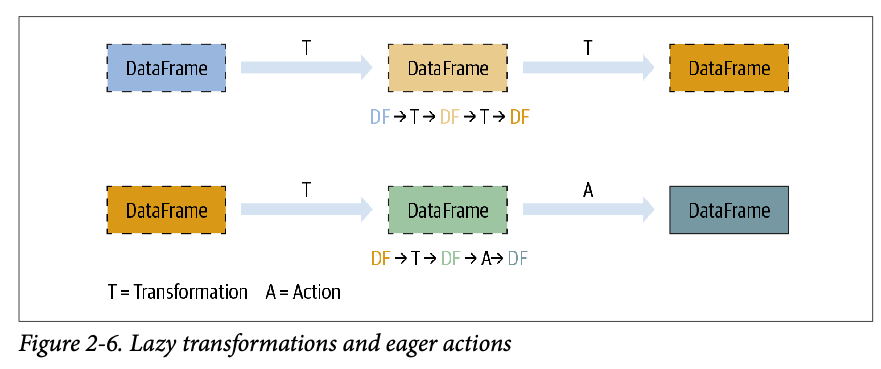
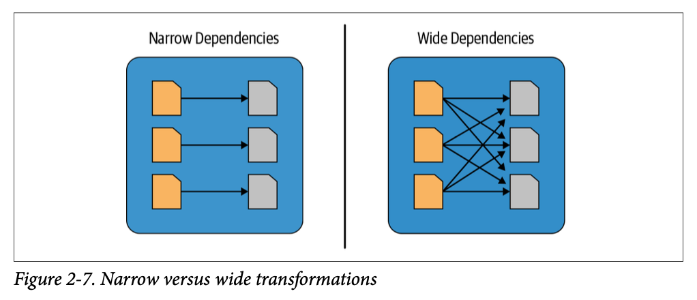

스파크 셸에서의 모든 처리가 하나의 머신에서 이루어지는 로컬 모드를 사용할 것이다. 이는 프레임워크를 익히면서 반복적인 스파크 수행이 가능하여 빠른 피드백을 얻을 수 있다. 하지만 분산 처리가 필요한 큰 데이터나 실무 작업에는 로컬 모드는 적합하지 않으며 대신 YARN이나 쿠버네티스 배포 모드를 써야 한다.

스파크 셸은 스칼라, 파이썬, R만 지원하지만 스파크 애플리케이션은 자바를 포함한 다양한 언어로 작성 가능하고, 쿼리는 스파크 SQL로 실행할 수 있다.

## 1단계: 아파치 스파크 다운로드

---

[스파크 다운로드](https://spark.apache.org/downloads.html)

위의 사이트로 가서 2번 드롭다운 메뉴에서 "Pre-built for Apache Hadoop"을 선택한다.



아파치 스파크 2.2 릴리스 이후 스파크를 파이썬으로 배우려는 개발자들에게는 **PyPI 저장소**로부터 파이스파크(PySpark)를 설치하는 방법이 있다. PyPI로 파이스파크를 설치하려면 단순히 `pip install pyspark`만 입력하면 된다.

SQL, ML, MLlib을 위한 추가적인 라이브러리도 `pip install pyspark[sql, ml, mllib]`이라는 명령어로 설치 가능하다.

### 스파크의 디렉터리와 파일들

타르볼(tarball) 파일 다운로드를 끝내고 나면 `cd` 명령어를 써서 다운로드 디렉터리로 간 후 `tar -xf ~/Downloads/spark-3.5.9-bin-hadoop3.tgz` 로 압축을 해제하고 다시 `cd`로 그 디렉터리로 들어간다.

그리면 아래와 같은 파일들을 볼 수 있다.

```bash
$ cd spark-3.5.9-bin-hadoop3
$ ls
bin        data       jars       LICENSE    NOTICE     R          RELEASE    yarn
conf       examples   kubernetes licenses   python     README.md  sbin
```

각 파일과 디렉터리의 의도와 목적은 다음과 같다.

- `README.md`
  - 스파크 셸을 어떻게 사용하는지, 소스에서 어떻게 빌드하는지, 어떻게 단독 스파크를 실행하는지, 스파크 문서의 링크와 설정 가이드를 어떻게 따라가는지, 어떻게 스파크에 기여하는 지 등 상세한 설명
- `bin`
  - **스파크 셸들을 포함해서**(`spark-sql`, `pyspark`, `spark-shell`, `sparkR`) 스파크와 상호 작용할 수 있는 대부분의 스크립트를 가짐
  - 셸과 실행 파일은 나중에 `spark-submit`을 써서 단독 스파크 애플리케이션을 제출하거나 쿠버네티스로 스파크를 실행할 때 도커 이미지를 만들고 푸시하는 스크립트 작성을 위해 사용
- `sbin`
  - 다양한 배포 모드에서 클러스터의 스파크 컴포넌트들을 시작하고 중지하기 위한 관리 목적
- `kubernetes`
  - 스파크 2.4 릴리즈부터 쿠버네티스 클러스터에서 쓰는 스파크를 위한 도커 이미지 제작을 위한 Dockerfile들과 도커 이미지를 빌드하기 전, 스파크 배포본을 어떻게 만들지에 대한 가이드 파일도 포함하고 있다.
- `data`
  - MLlib, 정형화 프로그래밍, GraphX 등에서 입력으로 사용되는 `*.txt` 파일이 있다.
- `examples`
  - 자바, 파이썬, R, 스칼라에 대한 예제들을 제공

## 2단계: 스칼라 혹은 파이스파크 셸 사용

---

대화형 '셸'로 동작하며 광범위하게 사용되는 `pyspark`, `spark-shell`, `spark-sql`, `sparkR`의 네 가지 인터프리터들이 포함되어 있어서 일회성 데이터 분석이 가능하다.

이 셸들은 클러스터에 연결하고 분산 데이터를 스파크 워커 노드의 메모리에 로드할 수 있도록 확장되어 왔다.

파이스파크를 시작하려면 `cd`로 `bin` 디렉터리로 가서 `pyspark`를 실행해서 셸을 띄운다. PyPI를 써서 파이스파크를 설치했다면 아무 데서나 그냥 `pyspark`를 실행하면 된다.

스칼라로 스파크 셸을 시작하려면 `cd`로 `bin` 디렉터리로 가서 `spark-shell`을 실행한다.

### 로컬 머신 사용하기

스파크 연산들은 작업으로 표현된다. 작업들은 태스크라고 불리는 저수준 RDD 바이트 코드로 변환되면 실행을 위해 스파크의 executor들에 분산된다.

데이터 프레임을 써서 텍스트 파일을 읽고, 읽은 문자열을 보여주고 파일의 줄 수를 세는 짧은 예제를 살펴보자.

- 스칼라 셸에서의 실행 화면
  
- 파이썬 셸에서의 실행 화면
  

어느 셸이든 빠져나가려면 Ctrl-D를 누른다.

## 3단계: 스파크 애플리케이션 개념의 이해

---

스파크 애플리케이션의 핵심 개념들과 코드가 어떻게 스파크 실행기에서 태스크로 변환되고 실행되는지를 배우기 전에 몇몇 중요한 용어들을 살펴보자.

- 애플리케이션
  - API를 써서 스파크 위에서 돌아가는 사용자 프로그램
  - 드라이버 프로그램과 클러스터의 실행기로 이루어짐
- SparkSession
  - 스파크 코어 기능들과 상호 작용할 수 있는 진입점을 제공하며 그 API로 프로그래밍을 할 수 있게 해주는 객체
  - 스파크 셸에서 스파크 드라이버는 기본적으로 `SparkSession`을 제공하지만 스파크 애플리케이션에서는 사용자가 `SparkSession` 객체를 생성해서 써야함
- 잡(job)
  - 스파크 액션(action, ex. `save()`, `collect()`)에 대한 응답으로 생성되는 여러 태스크(task)로 이루어진 병렬 연산
- 스테이지(stage)
  - 각 잡은 스테이지라 불리는 서로 의존성을 가지는 다수의 태스크 모음으로 나뉜다.
- 태스크(task)
  - Spark executor로 보내지는 작업 실행의 가장 기본적인 단위

### 스파크 애플리케이션과 SparkSession

모든 스파크 애플리케이션의 핵심에는 스파크 드라이버 프로그램이 있으며, 이 드라이버는 `SparkSession` 객체를 만든다. 스파크 셸을 써서 작업을 할 때 드라이버는 셸에 포함되어있는 형태에 `SparkSession` 객체가 미리 만들어진다.



`SparkSession` 객체를 만들었으면 이를 통해 스파크 연산을 수행하는 API를 써서 프로그래밍이 가능하다.

### 스파크 잡

드라이버는 스파크 애플리케이션을 하나 이상의 스파크 잡으로 변환한다. 그리고 각 잡은 DAG로 변환되며 이는 스파크의 실행 계획이 되며 이 DAG 그래프에서 각각의 노드는 하나 이상의 스파크 스테이지에 해당한다.



### 스파크 스테이지

작업이 연속적으로 또는 병렬적으로 수행되는지에 맞춰 스테이지에 해당하는 DAG 노드가 생성된다. 모든 스파크 연산이 하나의 스테이지 안에서 실행될 수 없으므로 여러 스테이지로 나뉘어야 한다.



### 스파크 태스크

각 스테이지는 최소 실행 단위이며 spark executor들 위에서 연합 실행되는 스파크 태스크들로 이루어진다. 각 태스크는 개별 CPU 코어에 할당되고 데이터의 개별 파티션을 갖고 작업한다.

16 core를 가진 executor라면, 16개 이상의 partition을 갖는 16개 이상의 태스크를 할당받아 작업하게 된다.



## 트랜스포메이션, 액션, 지연 평가

분산 데이터의 스파크 연산은 **트랜스포메이션(transformation)**과 **액션(action)**으로 구분된다.

- 트랜스포메이션 : 이미 불변성의 특징을 가진 원본 데이터를 수정하지 않고 하나의 스파크 데이터 프레임을 새로운 데이터 프레임으로 변형(transform)한다.
  - ex. `select()`나 `filter()` 같은 연산은 원본 데이터 프레임을 수정하지 않으며, 대신 새로운 데이터 프레임으로 연산 결과를 만들어 되돌림
  - 모든 트랜스포메이션은 뒤늦게 평가된다.
  - 즉시 계산되지 않고 **계보(lineage)**라 불리는 형태로 기록되며 이때, 리니지는 트랜스포메이션들끼리 재배열하거나 합치거나 해서 더 효율적으로 최적화한다.
- 액션 : 모든 기록된 트랜스포메이션의 지연 연산을 발동
  
    
  
  - 모든 트랜스포메이션 T는 액션 A를 호출할 때까지 기록되며 각 T는 새로운 데이터 프레임을 생성한다.

스파크는 액션(Action)이 호출될 때까지 트랜스포메이션 실행을 미루는 **지연 평가(Lazy Evaluation)**를 통해 전체 연산 과정을 미리 파악하고 쿼리 최적화(Query Optimization)를 달성한다.

이와 함께 데이터프레임의 **불변성** 덕분에 별도의 데이터 백업 없이도, 기록된 리니지(lineage)만으로 장애 내구성과 유연한 복구 체계를 확보할 수 있다.

---

### 좁은/넓은 트랜스포메이션

트랜스포메이션은 스파크가 지연 평가하는 연산 종류로 스파크가 연산 쿼리를 분석하고 어디를 최적화할지 알 수 있다는 점이 장점이다.

트랜스포메이션은 **좁은** 의존성과 **넓은** 의존성으로 분류할 수 있다.

- 좁은 의존성 : 하나의 입력 파티션을 연산하여 하나의 결과 파티션을 내놓는 트랜스포메이션
  - ex. `filter()`와 `contains()`는 하나의 파티션을 처리하여 데이터 교환 없이 결과 파티션을 생성
- 넓은 의존성 : 다른 파티션으로부터 데이터를 읽어 들여서 합치고 디스크에 쓰는 일
  - ex. `groupby()` 또는 `orderBy()`



## 스파크 UI

스파크는 **그래픽 유저 인터페이스(GUI)**를 써서 스파크 애플리케이션을 살표볼 수 있게 해주며 다양한 레벨(잡, 스테이지, 태스크 레벨)에서 확인 가능하다.

스파크가 배포된 방식에 맞춰 드라이버가 웹 UI를 띄우며 기본적으로 4040 포트를 사용하는데 여기서 다음과 같은 다양한 수치를 볼 수 있다.

- 스케줄러의 스테이지와 태스크 목록
- RDD 크기와 메모리 사용의 요약
- 환경 정보
- 실행 중인 executor 정보
- 모든 스파크 SQL 쿼리
