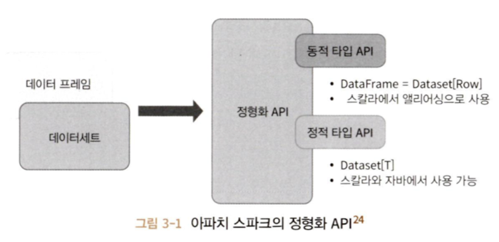
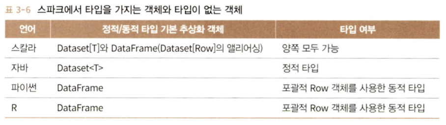
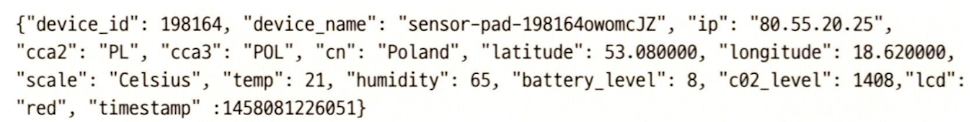
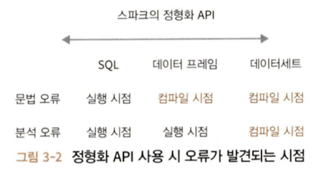
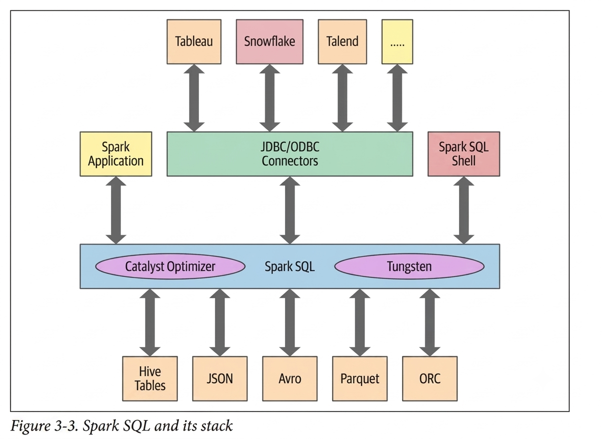
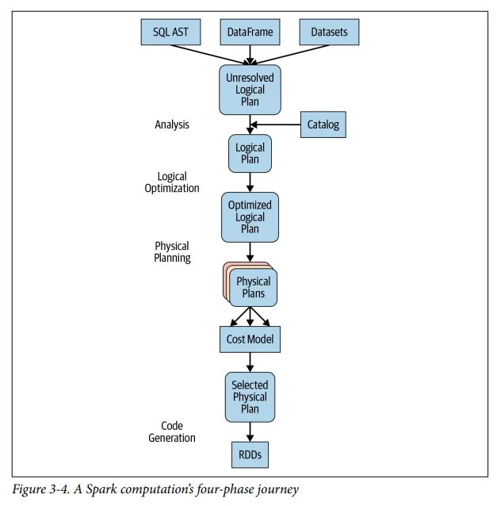
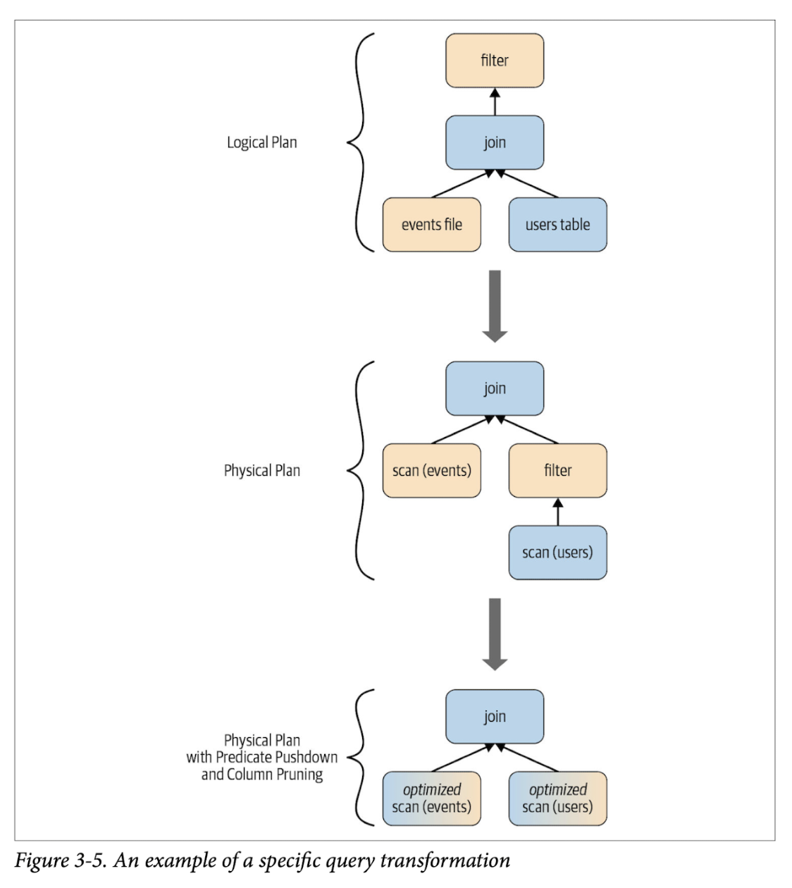

## 스파크: RDD의 아래에는 무엇이 있는가

---

RDD는 스파크에서 가장 기본적인 추상적 부분으로 세 가지의 핵심 특성이 있다.

- 의존성(dependency)
  - 어떤 입력을 필요로 하고 현재의 RDD가 어떻게 만들어지는지 스파크에게 가르침
  - 결과를 새로 만들어야 하는 경우 이 정보를 참고하고 연산을 다시 반복해서 RDD 재생성 &rarr; RDD에 유연성을 부여
- 파티션(지역성 정보 포함)
  - 스파크에게 작업을 나눠서 executor들에 분산해 파티션별로 병렬 연산할 수 있는 능력을 부여
  - ex. HDFS에서 파일을 읽는 경우 지역성 정보를 사용해 각 executor가 가까이 있는 데이터를 처리할 수 있는 executor에게 우선적으로 작업을 보냄
- 연산 함수: Partition &rarr; `Iterator[T]`
  - RDD에 저장되는 데이터를 `Iterator[T]` 형태로 만들어줌
  
이 원조 모델에는 아직 몇 가지 문제가 있었다.

- 사용자가 연산 함수 안에서 무얼 하는지 스파크가 알 수 없다.
  - 조인을 수행하든, 필터링을 수행하든, 선택이든 집계든 스파크에는 람다 표현식으로만 보임
- `Iterator[T]` 데이터 타입이 파이썬 RDD에서 불투명했으며, 스파크에서는 단지 파이썬 기본 객체로만 인식
- 스파크가 함수에서의 연산이나 표현식을 검사하지 못하다 보니 최적화하지 못함
- 스파크는 `T`로 표시한 타입에 대한 정보가 전혀 없어 스파크가 할 수 있는 어떤 데이터 압축 테크닉을 적용하지 못함

## 스파크의 구조 확립

---

스파크 2.x는 스파크 구조 확립을 위한 핵심 개념들을 도입했다.

- 데이터 분석을 통해 찾은 일상적인 패턴들을 써서 연산을 표현
  - 필터링, 선택, 집합연산, 집계, 평균, 그룹화 같은 고수준 연산으로 표현
- DSL에서 일반적인 연산 집합을 사용하여 API 사용이 가능
  - 이 연산자들은 스파크에게 데이터로 무엇을 작업하고 싶은지, 결과로 무엇을 원하는지 알려줄 수 있게 되어 실행을 위한 효율적인 플랜 작성이 가능
- SQL의 테이블이나 스프레드시트처럼, 지원하는 정형화 데이터 타입을 써서 데이터를 표 형태로 구성할 수 있게 됨

### 핵심적인 장점과 이득

구조를 갖추면 얻을 수 있는 이득은 다음과 같다.

- 표현성
- 단순성
- 구성 용이성
- 통일성
  
먼저 표현성과 구성 용이성과 관련된 코드 예시를 살펴보자. 아래 코드는 DSL 연산자들과 데이터 프레임 API를 써서 스파크에게 **무엇을 할지** 알려주는 코드이다.

```python
from pyspark.sql import SparkSession
from pyspark.sql.functions import avg
# SparkSession으로부터 데이터 프레임을 만든다
spark = (SparkSession
    .builder
    .appName("AuthorsAges")
    .getOrCreate())
# 데이터 프레임 생성
data_df = spark.createDataFrame([("Brooke", 20), ("Denny", 31), ("Jules", 30),
("TD", 35), ("Brooke", 25)], ["name", "age"])
# 동일한 이름으로 그룹화하여 나이별로 계산해 평균을 구한다.
avg_df = data_df.groupBy("name").agg(avg("age"))
# 최종 실행 결과를 보여준다.
avg_df.show()
```

## 데이터 프레임 API

---

스파크 데이터 프레임은 이름 있는 컬럼과 스키마를 가진 분산 인메모리 테이블처럼 동작하며, 각 컬럼은 다음과 같은 특정한 데이터 타입을 가질 수 있다. 사람이 보는 형태로는 스파크 데이터 프레임은 하나의 표처럼 보인다. 데이터 프레임은 불변성을 지니며 스파크는 그에 대한 모든 변경 내역을 보관한다. 또한, 보관한 채로 컬럼의 이름이나 타입을 추가하거나 바꿀 수 있으며 이름이 붙은 컬럼과 연관 데이터 타입은 스키마에 선언할 수 있다.

### 스파크의 기본 데이터 타입

스파크는 기본적인 내부 데이터 타입을 지원한다. 이 타입은 스파크 애플리케이션에서 선언할 수도 있고, 스키마에서 정의할 수도 있다.


### 스파크의 정형화된 타입과 복합 타입

복합 데이터 분석을 위해서는 단순하거나 기본적인 데이터 타입을 쓰지 않는다. 대상 데이터는 복합적이고 자체적 구조를 따로 갖고 있거나 내부적으로 반복될 것이다. 스파크는 이런 데이터 타입도 다룰 수 있다.


### 스키마와 데이터 프레임 만들기

스파크에서 **스키마(schema)**는 데이터 프레임을 위해 컬럼 이름과 연관된 데이터 타입을 정의한 것이다. 스키마는 외부 데이터 소스에서 구조화된 데이터를 읽어 들일 때 쓰이게 되는 경우가 가장 빈번하다. 이렇게 미리 스키마를 정의하는 것은 세 가지 장점이 있다.

- 스파크가 데이터 타입을 추측해야 하는 책임을 덜어 준다.
- 스파크가 스키마를 확정하기 위해 파일의 많은 부분을 읽어 들이려고 별도의 잡을 만드는 것을 방지한다. 데이터 파일이 큰 경우, 이는 비용과 시간이 많이 드는 작업이다.
- 데이터가 스키마와 맞지 않는 경우, 조기에 문제를 발견할 수 있다.

#### 스키마를 정의하는 두 가지 방법

스파크는 두 가지 방법으로 스키마를 정의할 수 있다.

- 프로그래밍 스타일로 정의하기
- `DDL(data definition language)`를 사용(좀 더 단순하며 읽기 쉬움)

```python
# 프로그래밍 방식
from pyspark.sql.types import *
schema = StructType([StructField("author", StringType(), False),
    StructField("title", StringType(), False),
    StructField("pages", IntegerType(), False)])
```

```python
# DDL
schema = "author STRING, title STRING, pages INT"
```

### 컬럼과 표현식

- 데이터 프레임에서 이름이 정해진 컬럼들은 어떤 특정한 타입의 필드를 나타내는 개념
- 사용자는 이름으로 컬럼들을 나열해 볼 수도 있고, 관계형 표현이나 계산식 형태의 표현식으로 그 값들에 연산을 수행할 수 있다.
- 스파크가 지원하는 언어들에서 컬럼은 공개 메소드를 가진 캑체, 즉 **컬럼**타입으로 표현된다. 또한 논리식이나 수학 표현식을 컬럼에 사용할수도 있다.
  - 스칼라, 자바, 파이썬 모두 컬럼과 연관된 공개 메서드들을 갖고 있다.

### 로우

- 스파크에서 하나의 행은 일반적으로 하나 이상의 컬럼을 갖고 있는 로우(row) 객체로 표현
- 각 컬럼은 동일한 컬럼 타입일 수도 있고 혹은 다른 타입들일 수도 있다.
- `Row`는 스파크의 객체이고 순서가 있는 필드 집합 객체이므로 스파크의 지원 언어들에서 각 필드를 0부터 시작하는 인덱스로 접근한다.

```python
from pyspark.sql import Row
blog_row = Row(6, "Reynold", "Xin", "https://tinyurl.6", 255568, "3/2/2015", ["twitter", "LinkedIn"])
# 인덱스로 개별 아이템을 접근
blog_row[1]
```

`Row` 객체들은 빠른 탐색을 위해 데이터 프레임을 만들어 사용하기도 한다.

```python
rows = [Row("Matei Zaharia", "CA"), Row("Reynold Xin", "CA")]
authors_df = spark.createDataFrame(rows, ["Authors", "State"])
authors_df.show()
```

실제로는 파일에서 데이터 프레임을 읽어 들여야 하는 상황이 일반적이고 파일 규모가 크기 때문에 스키마를 미리 지정해 사용하는 것이 데이터 프레임 작ㄱ성에 훨씬 더 빠르고 효율적이다.

### 자주 쓰이는 데이터 프레임 작업들

데이터 작업에서 자주 사용하는 데이터 프레임 작업들을 알아보자.

#### DataFrameReader와 DataFrameWriter 사용하기

스파크는 데이터 소스에서 데이터 프레임으로 로드하기 위해 DataFrameReader라는 이름의 인터페이스를 제공하며 이는 JSON, CSV, Parquet, Text, AVRO, ORC 포멧을 지원한다.

```python
from pyspark.sql.types import *
# 프로그래밍적인 방법으로 스키마를 정의
fire_schema = StructType([StructField('CallNumber', IntegerType(), True),  
                    StructField('UnitID', StringType(), True),  
                    StructField('IncidentNumber', IntegerType(), True),  
                    ...         
                    StructField('ALSUnit', BooleanType(), True),         
                    StructField('CallTypeGroup', StringType(), True),  
                    StructField('NumAlarms', IntegerType(), True),  
                    StructField('UnitType', StringType(), True),  
                    StructField('UnitSequenceInCallDispatch', IntegerType(), True),  
                    StructField('FirePreventionDistrict', StringType(), True),  
                    StructField('SupervisorDistrict', StringType(), True),  
                    StructField('Neighborhood', StringType(), True),  
                    StructField('Location', StringType(), True),  
                    StructField('RowID', StringType(), True),  
                    StructField('Delay', FloatType(), True)])

# DataFrameReader 인터페이스로 CSV 파일을 읽는다.
sf_fire_file = "/databricks-datasets/learning-spark-v2/sf-fire/sf-fire-calls.csv"
fire_df = spark.read.csv(sf_fire_file, header=True, schema=fire_schema)
```

데이터 프레임을 외부 데이터 소스에 원하는 포맷으로 쓰려면 `DataFrameWriter` 인터페이스를 사용할 수 있다. `DataFrameWriter`도 다양한 데이터 소스를 지원한다.

만약 데이터 프레임이 파케이로 쓰여졌다면 스키마는 파케이 메타데이터의 일부로 보존될 수 있어 수동으로 스키마를 적용할 필요가 없다.

일반적으로 많이 하는 데이터 작업으로, 데이터를 탐색하고 변환한 후 파케이 포맷이나 SQL 테이블로 데이터를 저장하는 것이다.

```python
# 데이터를 탐색하고 변환한 후 파케이 포맷이나 SQL 테이블로 데이터를 저장한다.
parquet_path = ...
fire_df.write.format("parquet").save(parquet_path)
```

```python
# 하이브 메타스토어에 메타데이터로 등록되는 테이블로 저장할 수 있다.
parquet_table = ...
fire_df.write.format("parquet").saveAsTable(parquet_table)
```

#### 트랜스포메이션과 액션

[Chapter 2 - 트랜스포메이션, 액션, 지연 평가](https://parkseojin2001.github.io/data-engineering/learning-spark/02/#%ED%8A%B8%EB%9E%9C%EC%8A%A4%ED%8F%AC%EB%A9%94%EC%9D%B4%EC%85%98-%EC%95%A1%EC%85%98-%EC%A7%80%EC%97%B0-%ED%8F%89%EA%B0%80)

#### 프로젝션과 필터

**프로젝션(projection)**은 필터를 이용해 특정 관계 상태와 매치되는 행들만 되돌려 주는 방법이다.

- projection은 `select()`로 수행되며 조건에 맞는 컬럼을 추출한다.
- filter는 `filter()`, `where()`로 표현되고 조건에 맞는 행을 추출한다.

```python
from pyspark.sql.functions import *

few_fire_df = (fire_df
    .select("IncidentNumber", "AvailableDtTm", "CallType")
    .where(col("CallType") != "Medical Incident"))
few_fire_df.show(5, truncate=False)

(fire_df
    .select("CallType")
    .where(col("CallType").isNotNull())
    .agg(countDistinct("CallType").alias("DistinctCallTypes"))
    .show())

(fire_df
    .select("CallType")
    .where(col("CallType").isNotNull())
    .distinct()
    .show(10, False))
```

#### 컬럼의 이름 변경 및 추가 삭제

컬럼 이름을 바꾸는 경우는 주로 스타일이나 컨벤션 준수 이유로, 혹은 가독성이나 간결성을 위해 특정 컬럼의 이름을 바꿔야할 때가 있다.

`StructField`를 써서 스키마 내에서 원하는 컬럼 이름들을 지정하면 결과 데이터 프레임에서 원하는 대로 컬럼 이름을 출력하는 방법이 있다.

다른 방법으로는 `withColumnRenamed()` 함수를 써서 원하는 이름으로 변경할 수 있다.

```python
new_fire_df = fire_df.withColumnRenamed("Delay", "ResponseDelayedinMins")
(new_fire_df
    .select("ResponseDelayedinMins")
    .where(col("ResponseDelayedinMins") > 5)
    .show(5, False))
```

이런 방식으로 컬럼 이름을 변경할 때는, 기본 컬럼 이름을 갖고 있는 원본을 유지한 채로 컬럼 이름이 변경된 새로운 데이터 프레임을 받아 오게 된다.

컬럼의 내용이나 타입을 바꾸는 작업도 가능하다. 예를 들어, 날짜나 시간 기반 데이터 분석을 할 때 컬럼 타입이 유닉스 타임스탬프나 SQL의 date 타입이 아니라 문자열 타입인 경우 작업의 편리성을 높이기 위해 컬럼 타입을 변경할 수 있다.

```python
fire_ts_df = (new_fire_df
    .withColumn("IncidentDate", to_timestamp(col("CallDate"), "MM/dd/yyyy"))
    .drop("CallDate")
    .withColumn("OnWatchDate", to_timestamp(col("WatchDate"), "MM/dd/yyyy"))
    .drop("WatchDate")
    .withColumn("AvailableDtTS", to_timestamp(col("AvailableDtTm"), "MM/dd/yyyy hh:mm:ss a"))
    .drop("AvailableDtTm"))
# 변환된 컬럼들을 가져온다.
(fire_ts_df
    .select("IncidentDate", "OnWatchDate", "AvailableDtTS")
    .show(5, False))
```

위의 작업을 거치면 데이터 탐색을 할 때 날짜/시간 컬럼을 다루는 함수를 적용할 수 있다.

```python
(fire_ts_df
    .select(year('IncidentDate'))
    .distinct()
    .orderBy(year('IncidentDate'))
    .show())
```

#### 집계 연산

`groupBy()`, `orderBy()`, `count()`와 같이 데이터 프레임에서 쓰는 일부 트랜스포메이션과 액션은 컬럼 이름으로 집계해서 각각 개수를 세어주는 기능을 제공한다.

```python
(fire_ts_df
    .select("CallType")
    .where(col("CallType").isNotNull())
    .groupBy("CallType")
    .count()
    .orderBy("count", ascending=False)
    .show(n=10, truncate=False))
```

#### 그 외 일반적인 데이터 프레임 연산들

데이터 프레임 API는 `min()`, `max()`, `sum()`, `avg()` 등 이름만으로 알 수 있을 만한 통계 함수를 지원한다.

```python
import pyspark.sql.functions as F
(fire_ts_df
    .select(F.sum("NumAlarms"), F.avg("ResponseDelayedinMins"),
    F.min("ResponseDelayedinMins"), F.max("ResponseDelayedinMins"))
    .show())
```

그 외에도 데이터 과학 작업에서 일반적으로 쓰이는 고수준 함수들로 `stat()`, `describe()`, `correlation()`, `covariance()`, `sampleBy()`, `approxQuantile()`, `frequentItems()` 등의 API가 있다.

## 데이터세트 API

---

데이터세트는 **정적 타입(typed)** API와 **동적 타입(untyped)** API의 두 특성을 모두 가진다.



스칼라의 데이터 프레임은 공용 객체의 모음인 `Dataset[Row]`의 다른 이름이라고 생각할 수 있으며 `Row`는 서로 다른 타입의 값을 저장할 수 있는 포괄적 JVM 객체라고 볼 수 있다. 반면 데이터세트는 스칼라에서 엄격하게 타입이 정해진 JVM 객체의 집합이며, 이 객체는 자바에서는 클래스라고 볼 수 있다.

스파크 문서에 따르면 데이터세트는 다음과 같다.

> 함수형/관계형 작업에서 병렬적으로 변형 가능한, 작업 분야에 특화된 객체들의 묶음이며 엄격하게 타입을 가짐. 각 데이터세트는 동시에 데이터 프레임이라고 불리는 동적 타입 뷰를 가지며 이는 `Row` 타입의 데이터세트다.

### 정적 타입 객체, 동적 타입 객체, 포괄적인 Row

스파크가 지원하는 언어들에서 데이터세트는 자바와 스칼라에서 통용되며, 반대로 파이썬과 R에서는 데이터 프레임만 사용 가능하다. 이는 파이썬과 R이 컴파일 시 타입의 안전을 보장하는 언어가 아니기 때문이다.



Row는 스파크의 포괄적 객체 타입이며 인덱스를 사용하여 접근할 수 있으며 다양한 타입의 값들을 담을 수 있다.

```python
from pyspark.sql import Row
row = Row(350, True, "Learning Spark 2E", None)
```

Row 객체에 공개되어 있는 **게터(getter)**류 함수들에 인덱스를 사용해 개별 필드에 접근할 수 있다.

```python
>>> row
<Row(350, True, 'Learning Spark 2E', None)>
>>> row[0]
350
>>> row[1]
True
>>> row[2]
'Learning Spark 2E'
>>> row[3]
```

반면 정적 객체들은 JVM에서 실제 자바 클래스나 스칼라 클래스가 되므로 데이터세트의 각 아이템들은 곧바로 하나의 JVM 객체가 되어 쓸 수 있다.

### 데이터세트 생성

데이터세트를 만들 때에 해당 스키마를 알아야 한다. 스칼라에서 데이터세트를 만들 때 결과 데이터세트가 쓸 스키마를 지정하는 가장 쉬운 방법은 스칼라의 케이스 클래스(case class)를 사용하는 것이다. 자바라면 자바빈(JavaBean) 클래스를 쓸 수 있다.

#### 스칼라: 케이스 클래스

특화된 객체를 데이터세트로 초기화해서 만들고 싶으면 스칼라에서 케이스 클래스를 정의해서 만들 수 있다.



위와 같은 행태의 JSON 문자열로 된 라인들이 있을 때 각 JSON 엔트리를 특화 객체인 `DeviceIoTData` 로 만들기 위해 다음과 같은 스칼라 케이스 클래스를 정의할 수 있다.

```scala
case class DeviceIoTData (battery_level: Long, c02_level: Long, cca2: String, cca3: String, 
cn: String, device_id: Long, device_name: String, humidity: Long, ip: String, latitude: Double,  
lcd: String, longitude: Double, scale:String, temp: Long, timestamp: Long)
```

케이스 클래스를 정의한 이후에는 파일을 읽어서 `Dataset[Row]`를 `Dataset[DeviceIoTData]`로 바꾸는 데에 사용 가능하다.

```scala
val ds = spark.read
  .json("/databricks-datasets/learning-spark-v2/iot-devices/iot_devices.json")
  .as[DeviceIoTData]

ds: org.apache.spark.sql.Dataset[DeviceIoTData] = [battery_level...]

ds.show(5, false)
```

### 데이터세트에서 가능한 작업들

데이터세트에서 트랜스포메이션이나 액션들을 수행할 수 있다.

```scala
val filterTempDS = ds.filter(d => d.temp > 30 && d.humidity > 70)

filterTempDS: org.apache.spark.sql.Dataset[DeviceIoTData] = [battery_level...]

filterTempDS.show(5, false)
```

DataSet의 함수인 `filter()`에 인자로 함수를 사용하였다. 시그니처는 `filter(func: (T) > Boolean): Dataset[T]`이고, 인자로 람다 함수 `func: (T) > Boolean`을 받는다.

람다 함수의 인자는 `DeviceIoTData`의 JVM 객체다.

```scala
case class DeviceTempByCountry(
  temp: Long, device_name: String, device_id: Long, cca3: String)
val dsTemp = ds
  .filter {d => d.temp > 25}
  .map {d => (d.temp, d.device_name, d.device_id, d.cca3)}
  .toDF("temp", "device_name", "device_id", "cca3")
  .as[DeviceTempByCountry]
dsTemp.show(5, false)
```

```scala
val device = dsTemp.first()
println(device)

device: DeviceTempByCountry =
DeviceTempByCountry(34, meter-gauge-1xbYRYcj, 1, USA)

val dsTemp2 = ds
  .select($"temp", $"device_name", $"device_id", $"cca3")
  .where("temp > 25")
  .as[DeviceTempByCountry]
```

데이터세트에서 `filter()`, `map()`, `groupBy()`, `select()`, `take()` 등을 수행할 수 있다. DataSet는 함수들의 형태다 컴파일 타임 안전성을 보장한다는 점에서 RDD와 유사하지만 훨씬 읽기 쉬우며 객체지향 프로그래밍 인터페이스를 갖고 있다.

데이터세트가 사용되는 동안은 하부의 스파크 SQL 엔진이 JVM 객체의 생성, 변환, 직렬화, 역직렬화를 담당한다. 그리고 데이터세트 인코더의 도움을 받아 자바의 오프힙 메모리 관리 또한 하게 된다.

## 데이터 프레임 vs 데이터세트

---

데이터 프레임과 데이터세트를 사용하는 경우를 정리하면 다음과 같다.

- 스파크에게 **어떻게 하는지**가 아니라 **무엇을 해야 하는지** 말하고 싶으면 데이터 프레임이나 데이터세트를 사용한다.
- 풍부한 표현과 높은 수준의 추상화 및 DSL 연산을 원한다면 데이터 프레임이나 데이터세트를 사용한다.
- 컴파일 타임에 엄격한 타입 체크를 원하며 특정한 `Dataset[T]`를 위해 여러 개의 케이스 클래스를 만드는 것에 부담이 없다면 데이터세트를 사용한다.
- 자신의 작업이 높은 수준의 표현력, 필터, 맵, 집계, 평균과 합계 계산, SQL 질의, 컬럼 지향 접근, 반정형화된 데이터에 대한 관계형 연산 등이 필요하다면 데이터 프레임이나 데이터세트를 사용한다.
- 자신의 작업이 SQL과 유사한 질의를 쓰는 관계형 변환을 필요로 한다면 데이터 프레임을 사용한다.
- 만약 인코더(Encoder)를 써서 프로젝트 텅스텐의 직렬화 능력을 통한 이득을 보고 싶다면 데이터세트를 사용한다.
- 일원화, 코드 최적화, 스파크 컴포넌트들 사이에서의 API 단순화 등을 원한다면 데이터 프레임을 사용한다.
- R 사용자라면, 데이터 프레임을 써야 한다.
- 파이썬 사용자라면 데이터 프레임을 쓰되, 제어권을 좀 더 갖고 싶으면 RDD로 바꿔 사용한다.
- 공간/속도의 효율성을 원한다면 데이터 프레임을 사용한다.
- 실행 시에 발생하는 에러를 찾기보다 컴파일 시에 발생하는 에러를 찾고 싶다면 아래 그림을 보고 적절한 API를 선택한다.

  

### 언제 RDD를 사용하는가

RDD 사용을 고려해보아야 할 만한 상황은 다음과 같다.

- RDD를 사용하도록 작성된 서드파티 패키지를 사용한다.
- 데이터 프레임과 데이터세트에서 얻을 수 있는 코드 최적화, 효과적인 공간 사용, 퍼포먼스의 이득을 포기할 수 있다.
- 스파크가 **어떻게** 질의를 수행할지 정확하게 지정해 주고 싶다.

추가적으로 데이터세트나 데이터 프레임에서 RDD로 가기 위해서는 단순한 API 함수인 `df.rdd`만 호출하면 된다(단, 변환 비용이 발생하므로 지양).

## 스파크 SQL과 하부의 엔진

---

SQL의 고수준 정형화 기능들이 구축되도록 해준 스파크 SQL 엔진은 다음과 같은 일을 한다.

- SQL 같은 질의를 수행
- 스파크 컴포넌트들을 통합하고 데이터 프레임/데이터 세트가 자바, 스칼라, 파이썬, R 등으로 정형화 데이터 관련 작업을 단순화할 수 있도록 추상화를 해준다.
- 아파치 하이브 메타스토어와 테이블에 접근한다.
- 정형화된 파일 포맷 (JSON, CSV, 텍스트, 에이브로, 파케이, ORC 등)에서 스키마와 정형화 데이터를 읽고 쓰며 데이터를 임시 테이블로 변환한다.
- 빠른 데이터 탐색을 할 수 있도록 대화형 스파크 SQL 셸을 제공한다.
- 표준 데이터베이스 JDBC/ODBC 커넥터를 통해 외부의 도구들과 연결할 수 있는 중간 역할을 한다.
- 최종 실행을 위해 최적화된 질의 계획과 JVM을 위한 최적화된 코드를 생성한다.



스파크 SQL 엔진의 핵심에는 카탈리스트 옵티마이저와 텅스텐 프로젝트가 있다. 이들은 상위 수준의 데이터 프레임과 데이터세트 API 및 SQL 쿼리 등을 지원한다.

### 카탈리스트 옵티마이저

카탈리스트 옵티마이저는 연산 쿼리를 받아 실행 계획으로 변환하며 네 단계를 거친다.

1. 분석 (Analysis)
   - Unresolved Logical Plan을 생성
   - 스파크 SQL 엔진은 SQL이나 데이터 프레임 쿼리를 위한 추상 문법 트리(AST) 생성으로 시작
   - 초기 단계에는 어떤 Column이나 Table 이름이든 간에 Column, Data Type, Function, Table, Database의 이름 목록을 갖고 있는 **Spark Programming Interface인 Catalog 객체로 접근하여 가져온다.**
   - Unresolved Logical Plan은 Logical Optimization의 Input이 된다.
2. 논리적 최적화 (Logical Optimization)
   - 표준적인 규칙을 기반으로 하는 최적화 접근 방식을 적용하면서, 먼저 여러 계획들을 수립한 후 CBO(Cost Based Optimizer)를 사용하여 각 계획에 비용을 책정
   - **계획들은 Operator Trees로 배열**이 된다.
     - ex. 이 트리들은 조건절을 아래 배치하고, Column을 걸러내고 Boolean 연산 단순화들을 진행
   - Logical Plan은 Pysical Planning의 Input이 된다.
3. 물리 계획 수립 (Physical Planning)
   - Spark 실행 엔진에서 선택된 **Logical Plan을 바탕으로 대응되는 Physical operators를 사용해 최적의 Physical Plan을 생성**
4. 코드 생성 (Code Generation)
   - 각 머신에서 **실행할 Java Byte Code를 생성**하며 Tunsten을 통해 최적화된 Code를 생성



```python
count_mnm_df = (mnm_df
    .select("State", "Color", "Count")
    .groupBy("State", "Color")
    .agg(count("Count")
    .alias("Total"))
    .orderBy("Total", ascending=False))

count_mnm_df.explain(True)  
```

위의 예제에서 파이썬 코드가 거치게 되는 다른 스테이지들을 보려면 데이터 프레임에서 `count_mnm_df.explain(True)` 함수를 실행하면 된다.

초반 분석 단계를 지난 후 질의 계획은 아래 그림처럼 변환 및 최적화된다.

