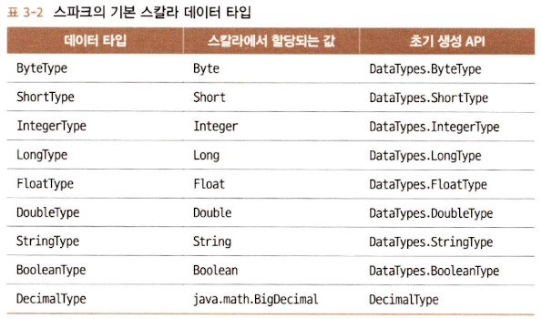
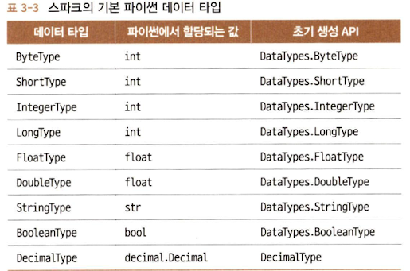
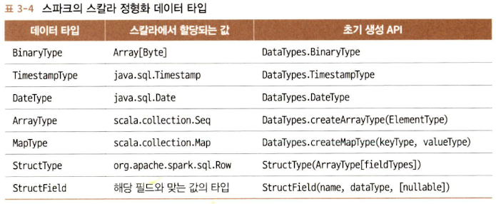
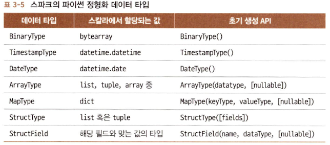

## 스파크: RDD의 아래에는 무엇이 있는가

---

RDD는 스파크에서 가장 기본적인 추상적 부분으로 세 가지의 핵심 특성이 있다.

- 의존성(dependency)
  - 어떤 입력을 필요로 하고 현재의 RDD가 어떻게 만들어지는지 스파크에게 가르침
  - 결과를 새로 만들어야 하는 경우 이 정보를 참고하고 연산을 다시 반복해서 RDD 재생성 &rarr; RDD에 유연성을 부여
- 파티션(지역성 정보 포함)
  - 스파크에게 작업을 나눠서 executor들에 분산해 파티션별로 병렬 연산할 수 있는 능력을 부여
  - ex. HDFS에서 파일을 읽는 경우 지역성 정보를 사용해 각 executor가 가까이 있는 데이터를 처리할 수 있는 executor에게 우선적으로 작업을 보냄
- 연산 함수: Partition &rarr; `Iterator[T]`
  - RDD에 저장되는 데이터를 `Iterator[T]` 형태로 만들어줌
  
이 원조 모델에는 아직 몇 가지 문제가 있었다.

- 사용자가 연산 함수 안에서 무얼 하는지 스파크가 알 수 없다.
  - 조인을 수행하든, 필터링을 수행하든, 선택이든 집계든 스파크에는 람다 표현식으로만 보임
- `Iterator[T]` 데이터 타입이 파이썬 RDD에서 불투명했으며, 스파크에서는 단지 파이썬 기본 객체로만 인식
- 스파크가 함수에서의 연산이나 표현식을 검사하지 못하다 보니 최적화하지 못함
- 스파크는 `T`로 표시한 타입에 대한 정보가 전혀 없어 스파크가 할 수 있는 어떤 데이터 압축 테크닉을 적용하지 못함

## 스파크의 구조 확립

---

스파크 2.x는 스파크 구조 확립을 위한 핵심 개념들을 도입했다.

- 데이터 분석을 통해 찾은 일상적인 패턴들을 써서 연산을 표현
  - 필터링, 선택, 집합연산, 집계, 평균, 그룹화 같은 고수준 연산으로 표현
- DSL에서 일반적인 연산 집합을 사용하여 API 사용이 가능
  - 이 연산자들은 스파크에게 데이터로 무엇을 작업하고 싶은지, 결과로 무엇을 원하는지 알려줄 수 있게 되어 실행을 위한 효율적인 플랜 작성이 가능
- SQL의 테이블이나 스프레드시트처럼, 지원하는 정형화 데이터 타입을 써서 데이터를 표 형태로 구성할 수 있게 됨

### 핵심적인 장점과 이득

구조를 갖추면 얻을 수 있는 이득은 다음과 같다.

- 표현성
- 단순성
- 구성 용이성
- 통일성
  
먼저 표현성과 구성 용이성과 관련된 코드 예시를 살펴보자. 아래 코드는 DSL 연산자들과 데이터 프레임 API를 써서 스파크에게 **무엇을 할지** 알려주는 코드이다.

```python
from pyspark.sql import SparkSession
from pyspark.sql.functions import avg
# SparkSession으로부터 데이터 프레임을 만든다
spark = (SparkSession
    .builder
    .appName("AuthorsAges")
    .getOrCreate())
# 데이터 프레임 생성
data_df = spark.createDataFrame([("Brooke", 20), ("Denny", 31), ("Jules", 30),
("TD", 35), ("Brooke", 25)], ["name", "age"])
# 동일한 이름으로 그룹화하여 나이별로 계산해 평균을 구한다.
avg_df = data_df.groupBy("name").agg(avg("age"))
# 최종 실행 결과를 보여준다.
avg_df.show()
```

## 데이터 프레임 API

---

스파크 데이터 프레임은 이름 있는 컬럼과 스키마를 가진 분산 인메모리 테이블처럼 동작하며, 각 컬럼은 다음과 같은 특정한 데이터 타입을 가질 수 있다. 사람이 보는 형태로는 스파크 데이터 프레임은 하나의 표처럼 보인다. 데이터 프레임은 불변성을 지니며 스파크는 그에 대한 모든 변경 내역을 보관한다. 또한, 보관한 채로 컬럼의 이름이나 타입을 추가하거나 바꿀 수 있으며 이름이 붙은 컬럼과 연관 데이터 타입은 스키마에 선언할 수 있다.

### 스파크의 기본 데이터 타입

스파크는 기본적인 내부 데이터 타입을 지원한다. 이 타입은 스파크 애플리케이션에서 선언할 수도 있고, 스키마에서 정의할 수도 있다.





### 스파크의 정형화된 타입과 복합 타입

복합 데이터 분석을 위해서는 단순하거나 기본적인 데이터 타입을 쓰지 않는다. 대상 데이터는 복합적이고 자체적 구조를 따로 갖고 있거나 내부적으로 반복될 것이다. 스파크는 이런 데이터 타입도 다룰 수 있다.





### 스키마와 데이터 프레임 만들기

스파크에서 **스키마(schema)**는 데이터 프레임을 위해 컬럼 이름과 연관된 데이터 타입을 정의한 것이다. 스키마는 외부 데이터 소스에서 구조화된 데이터를 읽어 들일 때 쓰이게 되는 경우가 가장 빈번하다. 이렇게 미리 스키마를 정의하는 것은 세 가지 장점이 있다.

- 스파크가 데이터 타입을 추측해야 하는 책임을 덜어 준다.
- 스파크가 스키마를 확정하기 위해 파일의 많은 부분을 읽어 들이려고 별도의 잡을 만드는 것을 방지한다. 데이터 파일이 큰 경우, 이는 비용과 시간이 많이 드는 작업이다.
- 데이터가 스키마와 맞지 않는 경우, 조기에 문제를 발견할 수 있다.

#### 스키마를 정의하는 두 가지 방법

스파크는 두 가지 방법으로 스키마를 정의할 수 있다.

- 프로그래밍 스타일로 정의하기
- `DDL(data definition language)`를 사용(좀 더 단순하며 읽기 쉬움)

```python
# 프로그래밍 방식
from pyspark.sql.types import *
schema = StructType([StructField("author", StringType(), False),
  StructField("title", StringType(), False),
  StructField("pages", IntegerType(), False)])
```

```python
# DDL
schema = "author STRING, title STRING, pages INT"
```

### 컬럼과 표현식

### 로우

### 자주 쓰이는 데이터 프레임 작업들

### 종단 간 데이터 프레임 예제

## 데이터세트 API

---

### 정적 타입 객체, 동적 타입 객체, 포괄적인 Row

### 데이터세트 생성

### 데이터세트에서 가능한 작업들

### 시작부터 끝까지 다룬 데이터세트 예제

## 데이터 프레임 vs 데이터세트

---

### 언제 RDD를 사용하는가

## 스파크 SQL과 하부의 엔진

---

### 카탈리스트 옵티마이저
