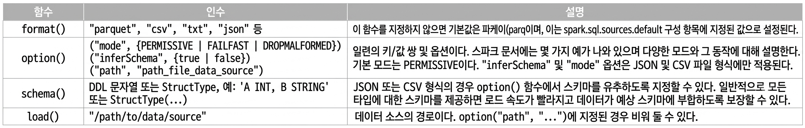
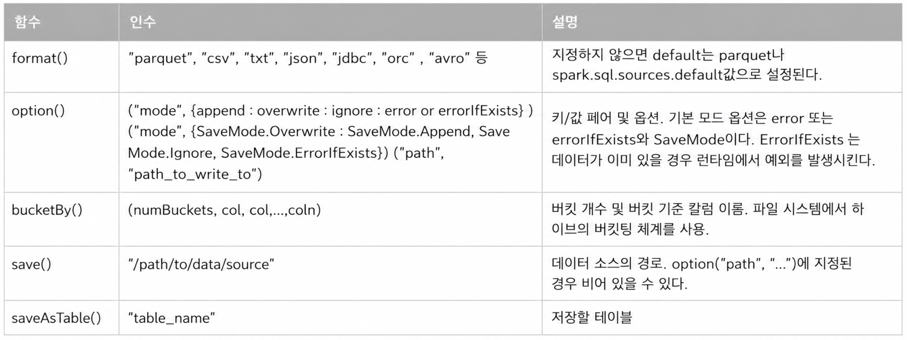

스파크 SQL은 다음과 같은 특징을 갖는다.

- 상위 수준의 정형화 API 엔진으로 제공
- 다양한 정형 데이터를 읽거나 쓸 수 있다(ex. JSON, 하이브 테이블, Parquet, Avro, ORC, CSV)
- 태블로(Tableau), 파워BI(Power BI), 탈렌드(Talend)와 같은 외부 비즈니스 인텔리전스(BI)의 데이터 소스나 MySQL 및 PostgreSQL과 같은 RDBMS의 데이터를 JDBC/ODBC 커넥터를 사용하여 쿼리할 수 있다.
- 스파크 애플리케이션에서 데이터베이스 안에 테이블 또는 뷰로 저장되어 있는 정형 데이터와 소통할 수 있도록 프로그래밍 인터페이스를 제공한다.
- SQL 쿼리를 정형 데이터에 대해 실행할 수 있는 대화형 셸을 제공한다.
- ANSI SQL: 2003 호환 명령 및 HiveQL을 지원한다.


## 스파크 애플리케이션에서 스파크 SQL 사용하기

---

스파크 2.0에서 소개된 SparkSession은 정형화 API로 스파크를 프로그래밍하기 위한 통합된 진입점을 제공한다. 스파크의 기능을 접근할 수 있는 SparkSession을 사용하면 쉽게 클래스를 가져오고 코드에서 인스턴스를 생성할 수 있다.

SQL 쿼리를 실행하기 위해선 spark라고 선언된 SparkSession 인스턴스에서 `spark.sql("SELECT * FROM myTableName")` 과 같은 `sql()` 함수를 사용한다. 이러한 방식으로 실행된 모든 `spark.sql` 쿼리는 원하는 경우 추가 스파크 작업을 수행할 수 있도록 데이터 프레임을 반환한다.

### 기본 쿼리 예제

일반적으로 독립 실행형 스파크 애플리케이션에서는 `SparkSession` 인스턴스를 수동으로 생성하지만 스파크 셸에서는 자동으로 생성되고 `spark`라는 이름을 통해 액세스할 수 있다.

```python
from pyspark.sql import SparkSession
# SparkSession 생성
spark = (SparkSession
    .builder
    .appName("SparkSQLExampleApp")
    .getOrCreate())
# 데이터세트 경로
csv_file = "/databricks-datasets/learning-spark-v2/flights/departuredelays.csv"

# 데이터 읽고 임시뷰를 생성
# 스키마 추론
df = (spark.read.format("csv")
    .option("inferSchema", "true")
    .option("header", "true")
    .load(csv_file))
df.createOrReplaceTempView("us_delay_flights_tbl")

# 더 큰 파일의 경우 스키마를 지정
schema = "'date' STRING, 'delay' INT, 'distance' INT, 'origin' STRING, 'destination' STRING"

# spark 쿼리
spark.sql("""SELECT distance, origin, destination
FROM us_delay_flights_tbl WHERE distance > 1000
ORDER BY distance DESC""").show(10)
```

`spark.sql` 인터페이스를 사용하면 일반적인 데이터 분석 작업을 수행할 수 있으며 계산은 스파크 SQL 엔진에서 동일한 과정을 거치며 동일한 결과를 제공한다.

위의 spark 쿼리는 모두 동등한 데이터 프레임 API 쿼리로 표현될 수 있다.

```python
from pyspark.sql.functions import col, desc
(df.select("distance", "origin", "destination")
    .where(col("distance") > 1000)
    .orderBy(desc("distance"))).show(10)
```

## SQL 테이블과 뷰

---

테이블은 데이터를 가지며 스파크는 각 테이블과 해당 데이터에 관련된 정보인 스키마, 설명, 테이블명, 데이터베이스명, 컬럼명, 파티션, 실제 데이터의 물리적 위치 등의 메타데이터를 가지고 있다. 이 모든 정보는 중앙 메타스토어에 저장된다.

스파크는 스파크 테이블만을 위한 별도 메타스토어를 생성하지 않고 기본적으로 `/user/hive/warehouse`에 있는 아파치 하이브 메타스토어를 사용하여 테이블에 대한 모든 메타데이터를 유지한다. 그러나 스파크 구성 변수 `spark.sql.warehouse.dir`을 로컬 또는 외부 분산 저장소로 설정하여 다른 위치로 기본 경로를 변경할 수 있다.

### 관리형 테이블과 비관리형 테이블

스파크는 **관리형**과 **비관리형**이라는 두 가지 유형의 테이블을 만들 수 있다.

- 관리형 테이블
  - 메타데이터와 파일 저장소의 데이터를 모두 관리한다.
    - 파일 저장소는 로컬 파일 시스템 또는 HDFS거나 Amazon S3 및 Azure Blob과 같은 객체 저장소일 수 있음
  - 스파크가 모든 것을 관리하기 때문에 `DROP TABLE <테이블명>`과 같은 SQL 명령은 메타데이터와 실제 데이터를 모두 삭제
- 비관리형 테이블
  - 오직 메타데이터만 관리하고 카산드라와 같은 외부 데이터 소스에서 데이터를 직접 관리
  - `DROP TABLE <테이블명>` 명령이 실제 데이터는 그대로 두고 메타데이터만 삭제한다.

### SQL 데이터 베이스와 테이블 생성하기

테이블은 데이터베이스 안에 존재하며 기본적으로 스파크는 default 데이터베이스 안에 테이블을 생성한다. 별도의 데이터베이스를 새로 생성하고 싶다면, 스파크 애플리케이션이나 노트북에서 SQL 명령어를 실행할 수 있다.

```python
# 데이터 베이스 생성 및 사용
spark.sql("CREATE DATABASE learn_spark_db")
spark.sql("USE learn_spark_db")
```

#### 관리형 테이블 생성하기

`learn_spark_db` 데이터베이스 안에 관리형 테이블을 생성하는 방법은 다음과 같다.

```python
spark.sql("CREATE TABLE managed_us_deplay_flights_tbl (date STRING, delay INT, distance INT, origin STRING, destination STRING)")
```

또한 데이터 프레임 API를 아래와 같이 사용하여 같은 명령을 수행할 수 있다.

```python
csv_file = "/databricks-datasets/learning-spark-v2/flights/departuredelays.csv"
schema = "data STRING, delay INT, distance INT, origin STRING, destination STRING"
flights_df = spark.read.csv(csv_file, schema=schema)
flights_df.write.saveAsTable("managed_us_delay_flights_tbl")
```

#### 비관리형 테이블 생성하기

스파크 애플리케이션에서 접근 가능한 파일 저장소에 있는 파케이, CSV 및 JSON 파일 포맷의 데이터 소스로부터 비관리형 테이블을 생성할 수 있다.

```python
spark.sql("""
    CREATE TABLE us_delay_flights_tbl (
        date STRING,
        delay INT,
        distance INT,
        origin STRING,
        destination STRING
)
USING csv OPTIONS (PATH '/databricks-datasets/learning-spark-v2/flights/departuredelays.csv')
""")
```

데이터 프레임 API에서는 다음과 같은 명령어를 사용한다.

```python
(flight_df
    .write
    .option("path", "/tmp/data/us_flights_delay")
    .saveAsTable("us_delay_flights_tbl"))
```

### 뷰 생성하기

스파크에서 기존 테이블을 토대로 뷰를 만들 수 있다. 뷰는 전역(해당 클러스터의 모든 `SparkSession`에서 볼 수 있음) 또는 세션 범위(단일 `SparkSession`에서만 볼 수 있음)일 수 있으며 일시적으로 스파크 애플리케이션이 종료되면 사라진다.

뷰 생성은 데이터베이스 내에서 테이블을 생성할 때와 유사하며 생성 후에는 테이블처럼 쿼리할 수 있다. 뷰는 테이블과 달리 실제로 데이터를 소유하지 않기 때문에 스파크 애플리케이션이 종료되면 테이블은 유지되지만 뷰는 사라진다.

```python
df_sfo = spark.sql("SELECT date, delay, origin, destination FROM us_delay_flights_tbl WHERE origin = 'SFO'")
df_jfk = spark.sql("SELECT date, delay, origin, destination FROM us_delay_flights_tbl WHERE origin = 'JFK'")

# Create a temporary and global temporary view
df.sfo.createOrReplaceGlobalTempView("us_origin_airport_SFO_global_tmp_view")
df.jfk.createOrReplaceTempView("us_origin_airport_JFK_tmp_view")
```

위의 코드처럼 뷰를 생성한 후에는 테이블에 대해 수행하는 것처럼 쿼리를 실행할 수 있다. 스파크는 `global_temp`라는 전역 임시 데이터베이스에 전역 임시 뷰를 생성하므로 해당 뷰에 액세스할 때는 `global_temp.<view_name>` 접두사를 사용해야 한다.

```python
# 전역 뷰 접근
spark.read.table("global_temp.us_origin_airport_SFO_global_tmp_view")
# 일반 뷰 접근
spark.read.table("us_origin_airport_JFK_tmp_view")
```

뷰도 테이블처럼 드롭할 수 있다.

```python
spark.catalog.dropGlobalTempView("us_origin_airport_SFO_global_tmp_view")
spark.catalog.dropTempView("us_origin_airport_JFK_tmp_view")
```

#### 임시 뷰 vs 전역 임시 뷰

- **임시 뷰** : 스파크 애플리케이션 내의 단일 `SparkSession`에 연결
- **전역 임시 뷰** : 스파크 애플리케이션 내의 여러 `SparkSession`에서 볼 수 있음

### 메타데이터 보기

메타데이터 저장을 위한 스파크 SQL의 상위 추상화 모듈인 **카탈로그**에 저장된다. 이 카탈로그는 데이터베이스, 테이블 및 뷰와 관련된 메타데이터를 검사한다. Spark 3.0에서는 외부 카탈로그를 사용할 수 있도록 개선되었다.

```python
# 메타데이터 액세스
spark.catalog.listDatabases()
spark.catalog.listTables()
spark.catalog.listColumns("us_delay_flights_tbl")
```

### SQL 테이블 캐싱하기

데이터 프레임처럼 SQL 테이블과 뷰 또한 캐시 및 언캐싱을 할 수 있다. 또한 Spark 3.0에서는 테이블을 `LAZY`로 지정, 즉 테이블을 바로 캐싱하지 않고 처음 사용되는 시점에서 캐싱한다.

```sql
CACHE [LAZY] TABLE <table-name>
UNCACHE TABLE <table-name>
```

### 테이블을 데이터 프레임으로 읽기

SQL을 사용하여 테이블을 쿼리하고 반환된 결과를 데이터 프레임으로 저장하는 코드는 다음과 같다.

```python
us_flights_df = spark.sql("SELECT * FROM us_delay_flights_tbl")
us_flights_df2 = spark.table("us_delay_flights_tbl")
```

## 데이터 프레임 및 SQL 테이블을 위한 데이터 소스

---

스파크 SQL은 다양한 데이터 소스에 대한 인터페이스를 제공하며 API를 사용하여 데이터를 읽고 쓸 수 있도록 함수를 제공한다. 이때 서로 다른 데이터 소스 간의 의사소통하는 방법을 제공하는 API로 `DataFrameReader` 및 `DataFrameWriter`가 있다.

### DataFrameReader

`DataFrameReader`는 데이터 소스에서 데이터 프레임으로 데이터를 읽기 위한 핵심 구조이며 정의된 형식과 권장되는 패턴이 있다.₩

```python
DataFrameReader.format(args).option("key", "value").schema(args).load()
```

다음 코드를 이용해 인스턴스 핸들을 얻을 수 있다.

```python
SparkSession.read
SparkSession.readStream
```

- `read`는 정적 데이터 소스에서 DataFrame으로 읽기 위해 `DataFrameReader`에 대한 핸들을 반환
- `readStream`은 스트리밍 소스에서 읽을 인스턴스를 반환

`DataFrameReader` 함수, 인수 및 옵션은 다음과 같다.



인수와 옵션의 예제를 살펴보자.

```python
file = "/databricks-datasets/learning-spark-v2/flights/summary-data/parquet/2010-summary.parquet"

# Parquet 형식 명시
df = spark.read.format("parquet").load(file)

# 기본 포맷(Parquet) 사용
df2 = spark.read.load(file)

# CSV 파일 읽기
df3 = (
    spark.read.format("csv")
    .option("inferSchema", "true")  
    .option("header", "true")
    .option("mode", "PERMISSIVE")
    .load("/databricks-datasets/learning-spark-v2/flights/summary-data/csv/*")
)

# JSON 파일 읽기
df4 = (
    spark.read.format("json")
    .load("/databricks-datasets/learning-spark-v2/flights/summary-data/json/*")
)
```

> 일반적으로 정적 파케이 데이터 소스에서 읽을때는 스키마가 필요하지 않지만 스트리밍 데이터 소스의 경우에는 스키마를 제공해야한다.
> 파케이 메타데이터는 보통 스키마를 포함하므로 스파크에서 스키마를 파악할 수 있다.

### DataFrameWriter

`DataFrameWriter`는 지정된 내장 데이터 소스에 데이터를 저장하거나 쓰는 작업을 수행한다. `SparkSession`이 아닌 저장하려는 데이터 프레임에서 인스턴스에 액세스가 가능하다.

권장되는 사용 형식은 다음과 같다.

```python
DataFrameWriter.format(args)
    .option(args)
    .bucketBy(args)
    .partitionBy(args)
    .save(path)

DataFrameWriter.format(args).option(args).sortBy(args).saveAsTable(table)
```

아래 코드로 인스턴스 핸들을 가져올 수 있다.

```python
DataFrame.write
DataFrame.writeStream
```

`DataFrame`의 각 함수에 지원되는 인수는 다음과 같다.



```python
location = "..."
df.write.format("json").mode("overwrite").save(location)
```

### 파케이

파케이(Parquet)는 스파크의 기본 데이터 소스이다. 파케이는 많은 빅데이터 처리 프레임워크 및 플랫폼에서 지원되고 다양한 I/O 최적화(저장 공간을 절약, 컬럼에 대한 빠른 액세스를 허용하는 압축)를 제공하는 오픈소스 컬럼 기반 파일 형식이다.

이러한 최적화와 효율성 때문에 데이터를 변환하고 정리한 후 파케이 형식으로 데이터 프레임을 저장하여 다운스트림에 사용하는 것이 좋다.

#### 파케이 파일을 데이터 프레임으로 읽기

파케이 파일은 데이터 파일, 메타데이터 여러 압축 파일 및 일부 상태 파일이 포함된 디렉토리 구조에 저장된다. 푸터(footer)의 메타데이터에는 파일 형식의 버전, 스키마, 경로 등의 컬럼 데이터가 포함된다.

파케이 파일을 데이터 프레임으로 읽으려면 형식과 경로를 지정하기만 하면 된다.

```python
file = """/databricks-datasets/learning-spark-v2/flights/summary-data/parquet/2010-summary.parquet/"""
df = spark.read.format("parquet").load(file)
```

파케이가 메타데이터의 일부로 저장하기 때문에, 스트리밍 데이터 소스에서 읽는 경우가 아니면 스키마를 제공할 필요가 없다.

#### 파케이 파일을 Spark SQL 테이블로 읽기

파케이 파일은 SQL을 사용하여 스파크 SQL 비관리형 테이블 또는 뷰를 직접 만들 수 있다.

```sql
CREATE OR REPLACE TEMPORARY VIEW us_delay_flights_tbl
    USING parquet
    OPTIONS (
        path "/databricks-datasets/learning-spark-v2/flights/summary-data/parquet/
        2010-summary.parquet/"
    )
```

테이블이나 뷰를 만든 후에 SQL을 사용하여 데이터를 데이터 프레임으로 읽을 수 있다.

```python
spark.sql("SELECT * FROM us_delay_flights_tbl").show()
```

#### 데이터 프레임을 파케이 파일로 쓰기

데이터 프레임을 작성하려면 `DataFrameWriter`에 대한 함수와 인수를 사용하여 파케이 파일을 저장할 위치를 제공하면 된다.

```python
(df.write.format("parquet")
    .mode("overwrite")
    .option("compression", "snappy")
    .save("/tmp/data/parquet/df_parquet"))
```

#### 스파크 SQL 테이블에 데이터 프레임 쓰기

SQL 테이블에 데이터 프레임을 쓸 떄는 `save()` 대신 `saveAsTable()`을 사용하면 된다.

```python
(df.write
    .mode("overwrite")
    .saveAsTable("us_delay_flights_tbl"))
```

파케이는 스파크에서 선호되는 기본 내장 데이터 소스 파일 형식이며 ETL 및 데이터 수집 프로세스에서 사용을 추천한다.

### 그 외 파일 데이터 형식

- JSON
  - 널리 사용되는 데이터 형식으로 XML에 비해 읽기 쉽고, 구문을 분석하기 쉬운 형식이다.
  - 단일 라인 모드 : 각 라인이 단일 JSON 개체를 나타냄
  - 다중 라인 모드 : 전체 라인 객체는 단일 JSON 개체를 구성
    - `option()` 함수에서 `multiLine`을 `true`로 설정해야 읽기 가능
- CSV
  - 일반 텍스트 파일로 널리 사용되며 파일 형식은 쉼표로 각 데이터 또는 필드를 구분하며, 쉼표로 구분된 각 줄은 레코드를 나타낸다.
  - 쉼표가 데이터의 일부인 경우 다른 구분 기호를 사용하여 필드 분리 가능
  - 스프레드시트가 CSV 파일을 생성할 수 있기 때문에 데이터 및 비즈니스 분석가들 사이에서 널리 사용되는 형식
- 에이브로(Avro)
  - 스파크 2.4에 내장된 데이터 소스로 소개된 형식으로 아파치 카프카에서 메시지를 직렬화 및 역직렬화할 때 사용
  - JSON에 대한 직접 매핑, 속도와 효율성, 많은 프로그래밍 언어에 사용할 수 있는 바인딩을 포함함
- ORC
  - 최적화된 컬럼 기반 파일 형식으로 Spark 2.x가 벡터화된 ORC 리더를 지원
  - 두가지 Spark 설정으로 어떤 ORC 구현체를 사용할지 지정 가능
    - `spark.sql.orc.impl`을 `native`로 설정하고 `spark.sql.orc.enableVectorizedReader`를 `true`로 설정하면 스파크는 벡터화된 ORC 리더를 사용
    - SQL 명령에서 `USING HIVE OPTIONS (fileFormat 'ORC')`을 통해 생성된 하이브 ORC SerDe(직렬화 및 역직렬화) 테이블의 경우, 스파크 구성 파라미터인 `spark.sql.hive.convertMetastoreOrc`가 `true`로 설정되었을 때 벡터화된 리더가 사용
  - 벡터화된 리더는 행 블록을 읽어 작업을 간소화하고 검색, 필터, 집계 및 조인과 같은 집중적인 작업에 대한 CPU 사용량을 줄임
- 이미지
  - 스파크 2.4에서 딥러닝 및 머신러닝 프레임워크를 지원하기 위해 새로운 데이터 소스로 도입
- 이진 파일
  - 스파크 3.0에서 지원하는 데이터 소스로 추가
  - `DataFrameReader`는 각 이진 파일을 파일의 원본 내용과 메타데이터를 포함하는 단일 데이터 프레임 행(레코드)로 변환
  - 이진 파일 데이터 소스는 다음과 같은 열이 있는 데이터 프레임 생성
    - 경로: StringType
    - 수정시간: TimestampType
    - 길이: LongType
    - 내용: BinaryType
  - 현재는 이진 파일 데이터 소스가 데이터 프레임에서 다시 원래 파일 형식으로 쓰는 것을 지원하지 않음
