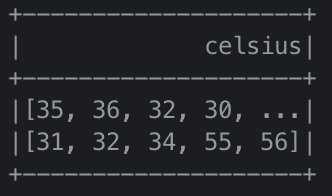

이번 장은 스파크 SQL을 사용하여 다음을 수행하는 방법에 대해 살펴볼 것이다.

- 아파치 하이브 및 아파치 스파크 모두에 대해 사용자 정의 함수를 사용한다.
- JDBC 및 SQL 데이터베이스, PostgreSQL, MySQL, 태블로, 애저 코스모스 DB 및 MS SQL 서버와 같은 외부 데이터 원본과 연결한다.
- 단순하거나 복잡한 유형, 고차 함수 그리고 일반적인 관계 연산자를 사용하여 작업한다.

또한 스파크 SQL을 사용하여 스파크에 쿼리하기 위해 스파크 SQL 셸, 비라인(Beeline) 및 태블로와 같은 몇 가지 다른 옵션을 살펴볼 것이다.

## 스파크 SQL과 아파치 하이브

---

스파크 SQL은 관계형 처리와 스파크의 함수형 프로그래밍 API를 통합하는 아파치 스파크의 기본 구성 요소로 더 빠른 성능 및 관계형 프로그래밍(ex. 선언적 쿼리 및 최적화된 스토리지)의 이점을 활용할 수 있을 뿐만 아니라 복잡한 분석 라이브러리(ex. 머신러닝)를 호출할 수 있다.

### 사용자 정의 함수

아파치 스파크는 대량의 내장 함수를 제공하기도 하지만, 사용자의 기능을 정의할 수 있는 유연성 또한 제공한다. 이를 **사용자 정의 함수(user-defined function, UDF)**라고 한다.

#### 스파크 SQL UDF

사용자만의 고유한 파이스파크 또는 스칼라 UDF를 생성하는 이점은 사용자(또는 다른 사용자)도 스파크 SQL 안에서 이를 사용할 수 있다는 것이다.

```python
from pyspark.sql.types import LongType

# 큐브 함수 생성
def cubed(s):
    return s * s * s

# UDF로 등록
spark.udf.register("cubed", cubed, LongType())

# 임시 뷰 생성
spark.range(1, 9).createOrReplaceTempView("udf_test")

# 큐브 UDF를 사용하여 쿼리
spark.sql("SELECT id, cubed(id) AS id_cubed FROM udf_test").show()
```

#### 스파크 SQL에서 평가 순서 및 null 검사

스파크 SQL(SQL, 데이터 프레임 API 및 데이터세트 API 포함)은 하위 표현식의 평가 순서를 보장하지 않는다. 예를 들어, 아래 쿼리는 `s is NOT NULL` 절이 `strlen(s) > 1`에 실행된다는 것을 보장하지 않는다.

```python
spark.sql("SELECT s FROM test1 WHERE s IS NOT NULL AND strlen(s) > 1")
```

따라서 적절한 `null` 검사를 수행하려면 다음을 수행하는 것이 좋다.

1. UDF 자체가 `null`을 인식하도록 만들고 UDF 내부에서 `null` 검사를 수행한다.
2. `IF` 또는 `CASE WHEN` 식을 사용하여 `null` 검사를 수행하고 조건 분기에서 UDF를 호출한다.

#### 판다스 UDF로 파이스파크 UDF 속도 향상 및 배포

파이스파크 UDF는 스칼라 UDF보다 성능이 느리다. 파이스파크 UDF가 JVM과 파이썬 사이의 데이터 이동을 필요로 해서 비용이 많이 들었기 때문이다. 이 문제를 해결하기 위해 판다스 UDF(벡터화된 UDF)가 아파치 스파크 2.3의 일부로 도입되었다.

판다스 UDF는 다음과 같은 특징이 있다.

- 판다스 UDF는 아파치 애로우(Arrow)를 사용하여 데이터를 전송하고 판다스는 해당 데이터로 작업을 진행
- `pandas_udf` 키워드를 데코레이터로 사용하여 판다스 UDF를 정의하거나 함수 자체를 래핑이 가능
- 아파치 애로우 형식에 포함된 데이터라면 이미 파이썬 프로세스에서 사용할 수 있는 형식이므로 더 이상 데이터를 직렬화나 피클(pickle)할 필요 X
- 행마다 개별 입력에 대해 작업하는 대신 판다스 시리즈 또는 데이터 프레임에서 작업(= 벡터화된 실행)

판다스 UDF는 파이썬 3.6 이상 기반의 아파치 스파크 3.0에서 두 가지 API 범주인 판다스 UDF 및 판다스 함수 API로 분할되었다.

- **판다스 UDF**
  - `Pandas.Series`, `pandas.DataFrame`, `Tuple` 및 `Iterator`와 같은 파이썬 유형 힌트로 판다스 UDF 유형을 유추
  - 시리즈와 시리즈, 시리즈 반복자와 시리즈 반복자, 다중 시리즈 반복자와 시리즈 반복자, 시리즈 스칼라(단일값)를 파이썬 유형 힌트로 지원
- **판다스 함수 API**
  - 입력과 출력이 모두 판다스 인스턴스인 파이스파크 데이터 프레임에 로컬 파이썬 함수를 직접 적용
  - 스파크 3.0의 경우 판다스 함수 API는 그룹화된 맵, 맵, 공동 그룹화된 맵을 지원
  
```python
# 판다스 가져오기
import pandas as pd

# Import various pyspark SQL functions including pandas_udf
from pyspark.sql.functions import col, pandas_udf
from pyspark.sql.types import LongType

# 큐브 함수 선언
def cubed(a: pd.Series) -> pd.Series:
    return a * a * a

# 큐브 함수에 대한 판다스 UDF 생성
cubed_udf = pandas_udf(cubed, returnType=LongType())

# 판다스 시리즈 생성
x = pd.Series([1, 2, 3])

# 로컬 판다스 데이터를 실행하는 pandas_udf에 대한 함수
print(cubed(x))
```

스파크를 데이터 프레임으로 전환하여 벡터화된 스파크 UDF로 실행할 수 있다.

```python
# 스파크 데이터 프레임 생성, 'spark'는 기존의 sparkSession과 같다.
df = spark.range(1, 4)

# 벡터화된 스파크 UDF를 함수로 실행
df.select("id", cubed_udf(col("id"))).show()
```

이전 로컬 함수는 오직 스파크 드라이버에서만 실행되는 판다스 함수였으나, 로컬 함수와 달리 벡터화된 UDF를 사용할 때 스파크 작업이 실행된다.

## 스파크 SQL 셸, 비라인 및 태블로로 쿼리하기

---

스파크 SQL 셸, 비라인(Beeline) CLI 유틸리티, 태블로 및 파워 BI와 같은 리포팅 툴을 포함하여 아파치 스파크를 쿼리하는 다양한 메커니즘이 있다.

### 스파크 SQL 셸 사용하기

스파크 SQL 쿼리를 실행하는 쉬운 방법은 spark-sql CLI이다.

스파크 SQL CPI를 시작하려면 `$SPARK_HOME` 폴더에서 다음 명령을 실행한다.

```bash
./bin/spark-sql
```

셸을 시작한 후에는 이를 사용하여 스파크 SQL 쿼리를 대화 형식으로 수행할 수 있다.

#### 테이블 만들기

새롭고 영구적인 스파크 SQL 테이블을 생성하려면 다음 명령어를 실행한다.

```sql
CREATE TABLE people (name STRING, age INT);
```

파일 경로를 이용한 저장 작업과 `people` 테이블 생성 작업의 결과가 서로 유사하게 적용된다.


#### 테이블에 데이터 삽입하기

`INSERT INTO people SELECT name, age FROM ...` 과 유사한 명령문을 실행하여 스파크 SQL 테이블에 데이터를 삽입할 수 있다.

기존 테이블이나 파일에서 데이터를 로드하는데 의존하지 않고 `INSERT... VALUES`문을 사용하여 테이블에 데이터를 삽입할 수 있다.


#### 스파크 SQL 쿼리 실행하기

테이블에 데이터가 있으므로 이에 대해 스파크 SQL 쿼리를 실행할 수 있다.


### 비라인 작업

SQLLine CLI를 기반으로 하는 JDBC 클라이언트다. 

#### 스리프트 서버 시작하기

스파크 스리프트 JDBC/ODBC 서버를 시작하려면 `$SPARK_HOME` 폴더에서 다음 명령으로 실행할 수 있다.

```bash
./sbin/start-thriftserver.sh
```

> 스파크 드라이버와 워커를 아직 시작하지 않은 경우 `start-thriftserver.sh` 실행 전에 다음 명령을 먼저 실행한다.
> ```bash
> ./sbin/start-all.sh
> ```

#### 비라인을 통해 스리프트 서버에 연결하기

비라인을 사용하여 스리프트 JDBC/ODBC 서버를 테스트하려면 다음 명령을 실행한다.

```bash
./bin/beeline
```

그런 다음 비라인을 구성하여 로컬 스리프트 서버에 연결한다.

```bash
!connect jdbc:hive2://localhost:10000
```

> 기본적으로 비라인은 비보안 모드이므로 사용자 이름은 로그인 계정이고 비밀번호는 비어 있다.

#### 비라인으로 스파크 SQL 쿼리 실행하기

비라인에서 쿼리를 실행하는 방법은 아래와 같이 실행할 수 있다.


#### 스리프트 서버 중지하기

완료되면 다음 명령을 사용하여 스리프트 서버를 중지할 수 있다.

```bash
./sbin/stop-thriftserver.sh
```

### 태블로로 작업하기

비라인 또는 스파크 SQL CLI를 통해 쿼리를 실행하는 것과 유사하게 스리프트 JDBC/ODBC 서버를 통해 선호하는 BI 도구를 스파크 SQL에 연결할 수 있다. 이 예시는 태블로 데스크탑을 로컬 아피치 스파크 인스턴스에 연결하는 방법이다.

#### 스리프트 서버 시작하기

스파크 스리프트 JDBC/ODBC 서버를 시작하려면 `$SPARK_HOME` 폴더에서 다음 명령을 실행하면 된다.

```bash
./sbin/start-thriftserver.sh
```

## 외부 데이터 소스

---

### JDBC 및 SQL 데이터베이스

스파크 SQL에는 JDBC를 사용하여 다른 데이터베이스에서 데이터를 읽을 수 있는 데이터 소스 API가 포함되어 있다. 결과를 데이터 프레임으로 반환할 때 이러한 데이터 소스 쿼리를 단순화하므로 스파크 SQL의 모든 이점을 제공한다.

시작하려면 JDBC 데이터 소스에 대한 JDBC 드라이버를 지정해야 하며 스파크 클래스 경로에 있어야 한다. `$SPARK_HOME` 폴더에서 다음과 같은 명령을 실행한다.

```bash
./bin/spark-shell --driver-class-path $database.jar --jars $database.jar
```

데이터 소스 API를 사용하여 원격 데이터베이스의 테이블을 데이터 프레임 또는 스파크 SQL 임시 뷰로 로드할 수 있다. 사용자는 데이터 소스 옵션에서 JDBC 연결 속성을 지정할 수 있다.

|속성명|설명|
|:---:|:---:|
|`user`, `password`|일반적으로 이러한 속성은 데이터 원본에 로그인하기 위한 연결 속성으로 제공된다.|
|`url`|JDBC 연결 URL|
|`dbtable`|읽거나 쓸 JDBC 테이블이다. dbtable과 query 옵션을 동시에 지정할 수 없다.|
|`query`|아파치 스파크에서 데이터를 읽는 데 사용되는 쿼리|
|`driver`|지정한 URL에 연결하는 데 사용할 JDBC 드라이버의 클래스 이름이다.|

#### 파티셔닝의 중요성

스파크 SQL과 JDBC 외부 소스 간에 많은 양의 데이터를 전송할 때 데이터 소스를 분할하는 것이 중요하다. 모든 데이터가 하나의 드라이버 연결을 통해 처리되므로 추출 성능을 포화 상태로 만들고 성능을 크게 저하시킬 수 있을 뿐 아니라 소스 시스템의 리소스를 포화 상태로 만들 수 있다.

|속성명|설명|
|:---:|:---:|
|`numPartitions`|테이블 읽기 및 쓰기에서 병렬 처리를 위해 사용할 수 있는 최대 파티션 수이다.<br>이것은 또한 최대 동시 JDBC 연결 수를 결정한다.|
|`partitionColumn`|외부 소스를 읽을 때 파티션을 결정하는 데 사용되는 컬럼이다.<br>숫자, 날짜 또는 타임스탬프 컬럼이어야한다.|
|`lowerBound`|파티션 크기에 대한 파티션 열의 최솟값을 설정한다.|
|`upperBound`|파티션 크기에 대한 파티션 열의 최댓값을 설정한다.|

다음과 같은 예를 들어보자.

- `numPartitions:10`
- `lowerBound:1000`
- `upperBound:10000`

이런 경우 파티션 크기는 1000이 되고 10개의 파티션이 생성된다. 이러한 속성을 사용할 때 주의해야 할 점이 있다.

- `numPartitions`의 좋은 시작접은 스파크 워커 수의 배수를 사용하는 것이다.
  - 단, 소스 시스템이 읽기 요청을 얼마나 잘 처리할 수 있는지도 확인해야한다.
  - 처리 윈도우가 있는 시스템은 동시 요청 수를 최대화할 수 있지만 없는 시스템은 포화 방지를 위해 동시 요청 수를 줄여야 한다.
- 처음에는 최소 및 최대 `partitionColumn`의 실제 값을 기준으로 `lowerBound` 및 `upperBound`를 기반으로 계산한다.
- 데이터 스큐를 방지하기 위해 균일하게 분산될 수 있는 `partitionColumn`을 선택해야 한다.

## PostgreSQL

---

PostgreSQL 데이터베이스에 연결하려면 메이븐에서 JDBC jar를 빌드하거나 다운로드한 후에 클래스 경로에 추가한다. 그런 다음 해당 jar를 지정하여 스파크 셸(`spark-shell` 또는 `pyspark`)을 시작한다.

```bash
bin/pyspark --jars postgresql-42.2.6.jar
```

파이썬으로 스파크 SQL 데이터 소스 API 및 JDBC를 사용하여 PostgreSQL 데이터베이스에서 로드하고 저장하는 방법은 아래 코드와 같다.

```python
# 읽기 방법 1: 로드 함수를 사용하여 JDBC 소스로부터 데이터를 로드
jdbcDF1 = (spark.read
    .format("jdbc")
    .option("url", "jdbc:postgresql://[DBSERVER]")
    .option("dbtable", "[SCHEMA].[TABLENAME]")
    .option("user", "[USERNAME]")
    .option("password", "[PASSWORD]")
    .load())

# 읽기 방법 2: jdbc 함수를 사용하여 JDBC 소스로부터 데이터를 로드
jdbcDF2 = (spark
    .read
    .jdbc("jdbc:postgresql://[DBSERVER]", "[SCHEMA].[TABLENAME]",
        properties={"user": "[USERNAME]", "password": "[PASSWORD]"}))

# 쓰기 방법 1: 저장 함수를 사용하여 JDBC 소스에 데이터를 저장
(jdbcDF1
    .write
    .format("jdbc")
    .option("url", "jdbc:postgresql://[DBSERVER]")
    .option("dbtable", "[SCHEMA].[TABLENAME]")
    .option("user", "[USERNAME]")
    .option("password", "[PASSWORD]")
    .save())

# 쓰기 방법 2: jdbc 함수를 사용하여 JDBC 소스에 데이터를 저장
(jdbcDF2
    .write
    .jdbc("jdbc:postgresql:[DBSERVER]", "[SCHEMA].[TABLENAME]",
        properties={"user": "[USERNAME]", "password": "[PASSWORD]"}))
```

### MySQL

MySQL 데이터베이스에 연결하려면 메이븐 또는 MySQL에서 JDBC jar를 빌드하거나 다운로드한 후에(후자가 더 쉽다) 클래스 경로에 추가한다. 그런 다음 해당 jar를 지정하여 스파크 셸(`spark-shell`) 또는 `pyspark`을 시작한다.

```bash
bin/pyspark --jars mysql-connector-java_8.0.16-bin.jar
```

아래 예시는 파이스파크에서 스파크 SQL 데이터 소스 API 및 JDBC를 사용하여 MySQL 데이터베이스에서 데이터를 로드하고 저장하는 방법이다.

```python
# 로드 함수를 사용하여 JDBC 소스로부터 데이터를 로드
jdbcDF = (spark
    .read
    .format("jdbc")
    .option("url", "jdbc:mysql://[DBSERVER]:3306/[DATABASE]")
    .option("driver", "com.mysql.jdbcDriver")
    .option("dbtable", "[TABLENAME]")
    .option("user", "[USERNAME]")
    .option("password", "[PASSWORD]")
    .load())

# 저장 함수를 사용하여 JDBC 소스에 데이터를 저장
(jdbcDF
    .write
    .format("jdbc")
    .option("url", "jdbc:mysql://[DBSERVER]:3306/[DATABASE]")
    .option("driver", "com.mysql.jdbcDriver")
    .option("dbtable", "[TABLENAME]")
    .option("user", "[USERNAME]")
    .option("password", "[PASSWORD]")
    .save())
```

### 애저 코스모스 DB

애저 코스모스 DB 데이터베이스에 연결하려면 메이븐 또는 깃허브에서 JDBC jar를 빌드하거나 다운로드하고 클래스 경로에 추가한다. 그런 다음 jar를 지정하여 스칼라 또는 파이스파크 셸을 시작한다.

```bash
bin/pyspark --jars azure-cosmosdb-spark_2.4.0_2.11:1.3.5-uber.jar
```

`--packages`를 사용하여 스파크 패키지에서 메이븐 좌표를 사용하여 커넥터를 끌어오는 옵션도 있다.

```bash
export PKG="com.microsoft.azure-cosmosdb-spark_2.4.0_2.11:1.3.5"
bin/spark-shell --packages $PKG
```

아래 예시는 파이스파크에서 스파크 SQL 데이터 소스 API 및 JDBC를 사용하여 애저 코스모스 DB 데이터베이스에서 데이터를 로드하고 저장하는 방법이다. 코스모스 DB 내의 다양한 인덱스를 사용하려면 `query_custom` 구성을 사용하는 것이 일반적이다.

```python
# 애저 코스모스 DB로부터 데이터 로드
# 설정 읽기
query = "SELECT c.colA, c.coln FROM c WHERE c.origin = 'SEA'"
readConfig = {
    "Endpoint" : "https://[ACCOUNT].documents.azure.com:443/",
    "Masterkey" : "[MASTER KEY]",
    "Database" : "[DATABASE]",
    "preferredRegions" : "Central US;East US2",
    "Collection" : "[COLLECTION]",
    "SamplingRatio" : "1.0",
    "schema_samplesize" : "1000",
    "query_pagesize" : "214783647",
    "query_custom" : query
}

# azure-cosmosdb-spark를 통해 연결하여 스파크 데이터 프레임 생성
df = (spark
    .read
    .format("com.microsoft.azure.cosmosdb.spark")
    .options(**readConfig)
    .load())

# 비행 수 카운트
df.count()

# 애저 코스모스 DB에 데이터 저장
# 설정 쓰기
writeConfig = {
    "Endpoint" : "https://[ACCOUNT].documents.azure.com:443/",
    "Masterkey" : "[MASTER KEY]",
    "Database" : "[DATABASE]",
    "Collection" : "[COLLECTION]",
    "Upsert" : "true"
}

# 애저 코스모스 DB에 데이터 프레임 업서트 하기
(df.write
    .format("com.microsoft.azure.cosmosdb.spark")
    .options(**writeConfig)
    .save())
```

### MS SQL 서버

MS SQL 서버 데이터베이스에 연결하려면 JDBC jar를 다운로드하고 클래스 경로에 추가한다. 그런 다음 jar를 지정하여 스칼라 또는 파이스파크 셸을 시작한다.

```bash
bin/spark-shell --jars mssql-jdbc-7.2.2.jre8.jar
```

아래 예시는 파이스파크에서 스파크 SQL 데이터 소스 API 및 JDBC를 사용하여 MS SQL 서버 데이터베이스에서 데이터를 로드하고 저장하는 방법이다.

```python
# jdbcUrl 설정
jdbcUrl = "jdbc:sqlserver://[DBSERVER]:1433;database=[DATABASE]"

# JDBC 소스로부터 데이터를 로드
jdbcDF = (spark
    .read
    .format("jdbc")
    .option("url", jdbcUrl)
    .option("dbtable", "[TABLENAME]")
    .option("user", "[USERNAME]")
    .option("password", "[PASSWORD]")
    .load())

# JDBC 소스에 데이터를 저장
(jdbcDF
    .write
    .format("jdbc")
    .option("url", jdbcUrl)
    .option("dbtable", "[TABLENAME]")
    .option("user", "[USERNAME]")
    .option("password", "[PASSWORD]")
    .save())
```

### 기타 외부 데이터 소스

위의 데이터 소스 외에도 아파치 스파크가 연결할 수 있는 데이터 소스는 다음과 같다.

- 아파치 카산드라
- 스노우플레이크
- 몽고DB

## 데이터 프레임 및 스파크 SQL의 고차 함수

---

복잡한 데이터 유형을 조작하는 일반적인 방법은 다음과 같다.

- 중첩된 구조를 개별 행으로 분해하고 일부 함수를 적용한 다음 중첩된 구조를 다시 만드는 방법
- 사용자 정의 함수 구축

이러한 접근 방식은 문제를 표 형식으로 생각할 수 있다는 이점이 있다.

### 방법 1: 분해 및 수집

`explode(values)`를 사용하여 `values` 내의 각 요소에 대한 새로운 행(`id` 포함)을 만든다.

```sql
SELECT id, collect_list(value + 1) AS values
FROM (SELECT id, EXPLODE(values) AS value
    FROM table) x
GROUP BY id
```

`collect_list()`가 중복된 개체 목록을 반환하지만 `GROUP BY`문에는 셔플 작업이 필요하다. 즉, 재수집된 배열의 순서가 원래 배열의 순서와 반드기 동일하지 않다. 값은 여러 차원이 될 수 있고, `GROUP BY`를 수행하므로 이 접근 방식이 매우 비쌀 수 있다.

### 방법 2: 사용자 정의 함수

동일한 작업을 수행하기 위해 `map()`을 사용하여 각 요소(값)를 반복하고 더하기 작업을 수행한는 UDF를 생성할 수도 있다.

```scala
def addOne(values: Seq[Int]): Seq[Int] = {
    values.map(value => value + 1)
}
val plusOneInt = spark.udf.register("plusOneInt", addOne(_: Seq[Int]): Seq[Int])
```

그런 다음 Spark SQL에서 이 UDF를 다음과 같이 사용할 수 있다.

```spark
spark.sql("SELECT id, plusOneInt(values) AS values FROM table").show()
```

이는 정렬 문제가 없기 때문에 `explode()` 및 `collect_list()`를 사용하는 것보다 낫지만, 직렬화 및 역직렬화 프로세스 자체는 비용이 많이 들 수 있다. 또한, 이 방식은 `collect_list()`를 사용하여 겪는 메모리 부족 문제를 완화할 수 있다는 장점이 있다.

### 복잡한 데이터 유형을 위한 내장 함수

이러한 잠재적으로 비용이 많이 드는 기술을 사용하는 대신, 복잡한 데이터 유형에 대해 아파치 스파크 2.4 이상 버전에 포함된 내장 함수를 사용할 수 있다.

참조 : [Apache Spark 내장 함수](https://spark.apache.org/docs/latest/api/sql/index.html)

### 고차 함수

위에서 언급한 내장 함수 외에도 익명 람다 함수를 인수로 사용하는 고차 함수가 있다. 고차 함수의 예는 다음과 같다.

```sql
transform(values, value -> lambda expression)
```

`transform()` 함수는 **배열(values)**과 익명 함수(**람다** 표현식)를 입력으로 사용한다. 이 함수는 각 요소에 익명 함수를 적용한 다음, 결과를 출력 배열에 할당함으로써 새로운 배열을 투명하게 생성한다(UDF 접근 방식과 유사하지만 더 효율적이다).

```python
from pyspark.sql.types import *
schema = StructType([StructField("celsius", ArrayType(IntegerType()))])

t_list = [[35, 36, 32, 30, 40, 42, 38]], [[31, 32, 34, 55, 56]]
t_c = spark.createDataFrame(t_list, schema)
t_c.createOrReplaceTempView("tC")

# 데이터 프레임 출력
t_c.show()
```

결과는 아래와 같다.




## 일반적인 데이터 프레임 및 스파크 SQL 작업

---

### Union

### Join

### 윈도우

### 수정
