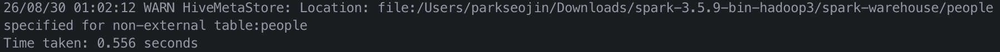
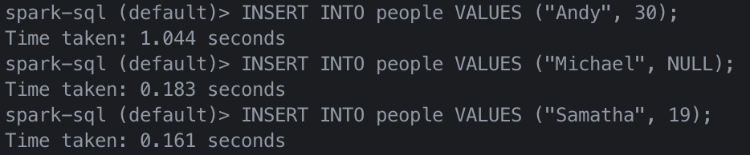
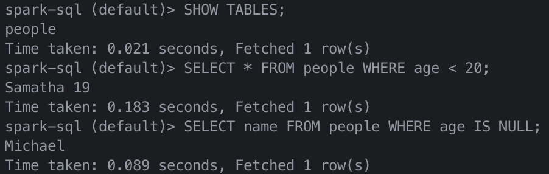
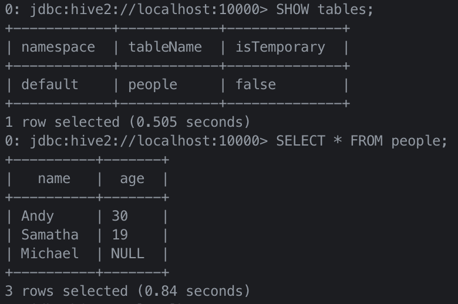

이번 장은 스파크 SQL을 사용하여 다음을 수행하는 방법에 대해 살펴볼 것이다.

- 아파치 하이브 및 아파치 스파크 모두에 대해 사용자 정의 함수를 사용한다.
- JDBC 및 SQL 데이터베이스, PostgreSQL, MySQL, 태블로, 애저 코스모스 DB 및 MS SQL 서버와 같은 외부 데이터 원본과 연결한다.
- 단순하거나 복잡한 유형, 고차 함수 그리고 일반적인 관계 연산자를 사용하여 작업한다.

또한 스파크 SQL을 사용하여 스파크에 쿼리하기 위해 스파크 SQL 셸, 비라인(Beeline) 및 태블로와 같은 몇 가지 다른 옵션을 살펴볼 것이다.

## 스파크 SQL과 아파치 하이브

---

스파크 SQL은 관계형 처리와 스파크의 함수형 프로그래밍 API를 통합하는 아파치 스파크의 기본 구성 요소로 더 빠른 성능 및 관계형 프로그래밍(ex. 선언적 쿼리 및 최적화된 스토리지)의 이점을 활용할 수 있을 뿐만 아니라 복잡한 분석 라이브러리(ex. 머신러닝)를 호출할 수 있다.

### 사용자 정의 함수

아파치 스파크는 대량의 내장 함수를 제공하기도 하지만, 사용자의 기능을 정의할 수 있는 유연성 또한 제공한다. 이를 **사용자 정의 함수(user-defined function, UDF)**라고 한다.

#### 스파크 SQL UDF

사용자만의 고유한 파이스파크 또는 스칼라 UDF를 생성하는 이점은 사용자(또는 다른 사용자)도 스파크 SQL 안에서 이를 사용할 수 있다는 것이다.

```python
from pyspark.sql.types import LongType

# 큐브 함수 생성
def cubed(s):
    return s * s * s

# UDF로 등록
spark.udf.register("cubed", cubed, LongType())

# 임시 뷰 생성
spark.range(1, 9).createOrReplaceTempView("udf_test")

# 큐브 UDF를 사용하여 쿼리
spark.sql("SELECT id, cubed(id) AS id_cubed FROM udf_test").show()
```

#### 스파크 SQL에서 평가 순서 및 null 검사

스파크 SQL(SQL, 데이터 프레임 API 및 데이터세트 API 포함)은 하위 표현식의 평가 순서를 보장하지 않는다. 예를 들어, 아래 쿼리는 `s is NOT NULL` 절이 `strlen(s) 1절 이전`에 실행된다는 것을 보장하지 않는다.

```python
spark.sql("SELECT s FROM test1 WHERE s IS NOT NULL AND strlen(s) > 1")
```

따라서 적절한 `null` 검사를 수행하려면 다음을 수행하는 것이 좋다.

1. UDF 자체가 `null`을 인식하도록 만들고 UDF 내부에서 `null` 검사를 수행한다.
2. `IF` 또는 `CASE WHEN` 식을 사용하여 `null` 검사를 수행하고 조건 분기에서 UDF를 호출한다.

#### 판다스 UDF로 파이스파크 UDF 속도 향상 및 배포

파이스파크 UDF는 스칼라 UDF보다 성능이 느리다. 파이스파크 UDF가 JVM과 파이썬 사이의 데이터 이동을 필요로 해서 비용이 많이 들었기 때문이다. 이 문제를 해결하기 위해 판다스 UDF(벡터화된 UDF)가 아파치 스파크 2.3의 일부로 도입되었다.

판다스 UDF는 다음과 같은 특징이 있다.

- 판다스 UDF는 아파치 애로우(Arrow)를 사용하여 데이터를 전송하고 판다스는 해당 데이터로 작업을 진행
- `pandas_udf` 키워드를 데코레이터로 사용하여 판다스 UDF를 정의하거나 함수 자체를 래핑이 가능
- 아파치 애로우 형식에 포함된 데이터라면 이미 파이썬 프로세스에서 사용할 수 있는 형식이므로 더 이상 데이터를 직렬화나 피클(pickle)할 필요 X
- 행마다 개별 입력에 대해 작업하는 대신 판다스 시리즈 또는 데이터 프레임에서 작업(= 벡터화된 실행)

판다스 UDF는 파이썬 3.6 이상 기반의 아파치 스파크 3.0에서 두 가지 API 범주인 판다스 UDF 및 판다스 함수 API로 분할되었다.

- **판다스 UDF**
  - `Pandas.Series`, `pandas.DataFrame`, `Tuple` 및 `Iterator`와 같은 파이썬 유형 힌트로 판다스 UDF 유형을 유추
  - 시리즈와 시리즈, 시리즈 반복자와 시리즈 반복자, 다중 시리즈 반복자와 시리즈 반복자, 시리즈 스칼라(단일값)를 파이썬 유형 힌트로 지원
- **판다스 함수 API**
  - 입력과 출력이 모두 판다스 인스턴스인 파이스파크 데이터 프레임에 로컬 파이썬 함수를 직접 적용
  - 스파크 3.0의 경우 판다스 함수 API는 그룹화된 맵, 맵, 공동 그룹화된 맵을 지원
  
```python
# 판다스 가져오기
import pandas as pd

# Import various pyspark SQL functions including pandas_udf
from pyspark.sql.functions import col, pandas_udf
from pyspark.sql.types import LongType

# 큐브 함수 선언
def cubed(a: pd.Series) -> pd.Series:
    return a * a * a

# 큐브 함수에 대한 판다스 UDF 생성
cubed_udf = pandas_udf(cubed, returnType=LongType())

# 판다스 시리즈 생성
x = pd.Series([1, 2, 3])

# 로컬 판다스 데이터를 실행하는 pandas_udf에 대한 함수
print(cubed(x))
```

스파크를 데이터 프레임으로 전환하여 벡터화된 스파크 UDF로 실행할 수 있다.

```python
# 스파크 데이터 프레임 생성, 'spark'는 기존의 sparkSession과 같다.
df = spark.range(1, 4)

# 벡터화된 스파크 UDF를 함수로 실행
df.select("id", cubed_udf(col("id"))).show()
```

이전 로컬 함수는 오직 스파크 드라이버에서만 실행되는 판다스 함수였으나, 로컬 함수와 달리 벡터화된 UDF를 사용할 때 스파크 작업이 실행된다.

## 스파크 SQL 셸, 비라인 및 태블로로 쿼리하기

---

스파크 SQL 셸, 비라인(Beeline) CLI 유틸리티, 태블로 및 파워 BI와 같은 리포팅 툴을 포함하여 아파치 스파크를 쿼리하는 다양한 메커니즘이 있다.

### 스파크 SQL 셸 사용하기

스파크 SQL 쿼리를 실행하는 쉬운 방법은 spark-sql CLI이다.

스파크 SQL CPI를 시작하려면 `$SPARK_HOME` 폴더에서 다음 명령을 실행한다.

```bash
./bin/spark-sql
```

셸을 시작한 후에는 이를 사용하여 스파크 SQL 쿼리를 대화 형식으로 수행할 수 있다.

#### 테이블 만들기

새롭고 영구적인 스파크 SQL 테이블을 생성하려면 다음 명령어를 실행한다.

```sql
CREATE TABLE people (name STRING, age INT);
```

파일 경로를 이용한 저장 작업과 `people` 테이블 생성 작업의 결과가 서로 유사하게 적용된다.



#### 테이블에 데이터 삽입하기

`INSERT INTO people SELECT name, age FROM ...` 과 유사한 명령문을 실행하여 스파크 SQL 테이블에 데이터를 삽입할 수 있다.

기존 테이블이나 파일에서 데이터를 로드하는데 의존하지 않고 `INSERT... VALUES`문을 사용하여 테이블에 데이터를 삽입할 수 있다.



#### 스파크 SQL 쿼리 실행하기

테이블에 데이터가 있으므로 이에 대해 스파크 SQL 쿼리를 실행할 수 있다.



### 비라인 작업

SQLLine CLI를 기반으로 하는 JDBC 클라이언트다. 

#### 스리프트 서버 시작하기

스파크 스리프트 JDBC/ODBC 서버를 시작하려면 `$SPARK_HOME` 폴더에서 다음 명령으로 실행할 수 있다.

```bash
./sbin/start-thriftserver.sh
```

> 스파크 드라이버와 워커를 아직 시작하지 않은 경우 `start-thriftserver.sh` 실행 전에 다음 명령을 먼저 실행한다.
> ```bash
> ./sbin/start-all.sh
> ```

#### 비라인을 통해 스리프트 서버에 연결하기

비라인을 사용하여 스리프트 JDBC/ODBC 서버를 테스트하려면 다음 명령을 실행한다.

```bash
./bin/beeline
```

그런 다음 비라인을 구성하여 로컬 스리프트 서버에 연결한다.

```bash
!connect jdbc:hive2://localhost:10000
```

> 기본적으로 비라인은 비보안 모드이므로 사용자 이름은 로그인 계정이고 비밀번호는 비어 있다.

#### 비라인으로 스파크 SQL 쿼리 실행하기

비라인에서 쿼리를 실행하는 방법은 아래와 같이 실행할 수 있다.



#### 스리프트 서버 중지하기

완료되면 다음 명령을 사용하여 스리프트 서버를 중지할 수 있다.

```bash
./sbin/stop-thriftserver.sh
```

### 태블로로 작업하기

비라인 또는 스파크 SQL CLI를 통해 쿼리를 실행하는 것과 유사하게 스리프트 JDBC/ODBC 서버를 통해 선호하는 BI 도구를 스파크 SQL에 연결할 수 있다. 이 예시는 태블로 데스크탑을 로컬 아피치 스파크 인스턴스에 연결하는 방법이다.

#### 스리프트 서버 시작하기

스파크 스리프트 JDBC/ODBC 서버를 시작하려면 `$SPARK_HOME` 폴더에서 다음 명령을 실행하면 된다.

```bash
./sbin/start-thriftserver.sh
```

## 외부 데이터 소스

---

### JDBC 및 SQL 데이터베이스

스파크 SQL에는 JDBC를 사용하여 다른 데이터베이스에서 데이터를 읽을 수 있는 데이터 소스 API가 포함되어 있다. 결과를 데이터 프레임으로 반환할 때 이러한 데이터 소스 쿼리를 단순화하므로 스파크 SQL의 모든 이점을 제공한다.

시작하려면 JDBC 데이터 소스에 대한 JDBC 드라이버를 지정해야 하며 스파크 클래스 경로에 있어야 한다. `$SPARK_HOME` 폴더에서 다음과 같은 명령을 실행한다.

```bash
./bin/spark-shell --driver-class-path $database.jar --jars $database.jar
```

데이터 소스 API를 사용하여 원격 데이터베이스의 테이블을 데이터 프레임 또는 스파크 SQL 임시 뷰로 로드할 수 있다. 사용자는 데이터 소스 옵션에서 JDBC 연결 속성을 지정할 수 있다.

#### 파티셔닝의 중요성


## PostgreSQL

---

### MySQL

### 애저 코스모스 DB

### MS SQL 서버

### 기타 외부 데이터 소스

## 데이터 프레임 및 스파크 SQL의 고차 함수

---

### 방법 1: 분해 및 수집

### 방법 2: 사용자 정의 함수

### 복잡한 데이터 유형을 위한 내장 함수

### 고차 함수

## 일반적인 데이터 프레임 및 스파크 SQL 작업

---

### Union

### Join

### 윈도우

### 수정


 