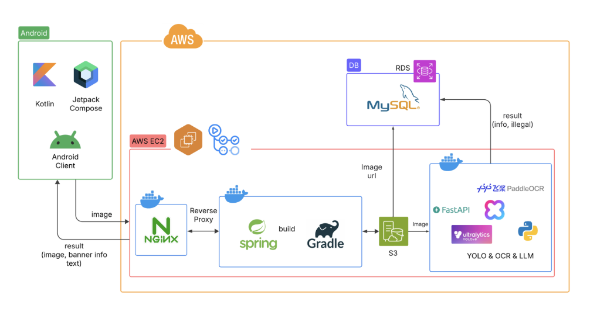
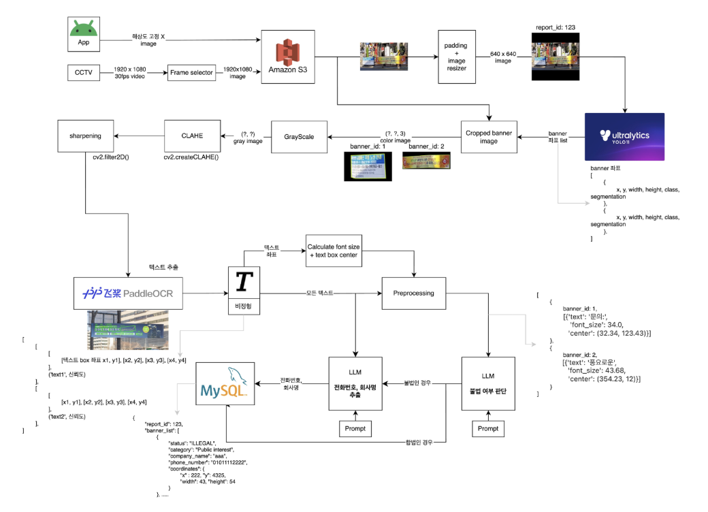
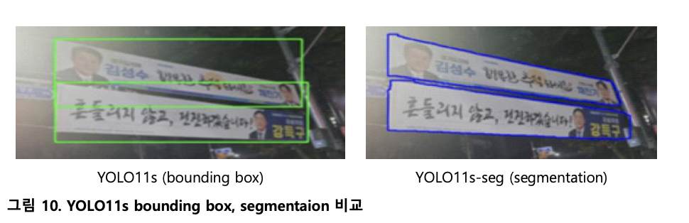
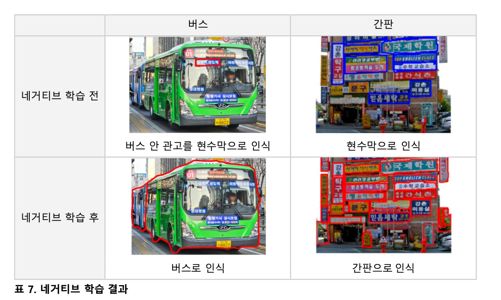

## 문제 정의

불법 현수막은 도시 미관과 도로 안전을 해치지만, 단속은 대부분 사람이 직접 처리합니다. 경기도에서만 최근 8년간 약 2,675만 건이 적발될 만큼 규모도 큽니다.

기존 신고 앱은 시민이 **불법 여부를 스스로 판단**하고 사진과 위치를 직접 입력해야 해서 불편했습니다. 법적으로 불법 현수막은 지정 게시대 밖에 걸린 **상업 목적** 현수막이므로, 이 판단을 AI가 대신하면 신고 과정을 크게 줄일 수 있다고 봤습니다.

**목표**: 사용자가 현수막 사진을 올리면 AI가 현수막을 찾고, 글자를 읽고, 불법 여부를 판단해 신고 기록으로 남기는 앱을 만든다.

## 아키텍처



- Android 앱이 사진을 올리면 NGINX를 거쳐 Spring Boot 서버가 받습니다.
- 서버는 이미지를 S3에 저장하고 **URL만 AI 서버에 넘깁니다.** 이미지를 직접 주고받지 않아 전송 병목을 피합니다.
- AI 서버는 탐지 → 글자 인식 → 분류를 거쳐 결과를 JSON으로 돌려주고, 서버가 RDS(MySQL)에 저장합니다.
- NGINX, Spring, AI 서버는 각각 Docker 컨테이너로 EC2에 분리 배포했습니다.

## 데이터 수집

- **탐지용 이미지**: Roboflow의 공개 현수막 이미지를 모으고, 부족한 형태는 직접 촬영해 보충했습니다. 현수막과 지정 게시대를 직접 라벨링했고, 오탐 문제가 드러난 뒤에는 버스와 간판을 추가로 라벨링했습니다.
- **분류용 텍스트**: 수집한 현수막 문구를 문장 단위로 정치 / 공익 / 상업 / 기타 중 하나로 직접 라벨링했습니다.
- **파이프라인 출력 데이터**: 현수막 사진을 실제 YOLO + OCR 파이프라인에 통과시킨 결과(글자, 크기, 중심 좌표, 신뢰도)에 정답 분류를 붙여, LLM이 실제로 받게 될 입력과 같은 형태의 데이터를 따로 만들었습니다.

## 주요 기여

### AI 파이프라인 설계와 서버 구축

탐지, 글자 인식, 분류는 서로 다른 모델입니다. 사진 한 장이 들어왔을 때 세 모델을 어떤 순서로 돌리고, 각 단계가 다음 단계에 무엇을 넘길지 정하는 것이 파이프라인 설계의 핵심이었습니다.



1. **입력**: 백엔드가 보낸 S3 이미지 URL로 사진을 받아, 원본 비율을 유지하도록 padding을 넣어 640×640으로 맞춥니다.
2. **탐지 후처리**: YOLO가 돌려준 클래스·박스·마스크로 현수막을 걸러 냅니다.
   - 현수막이 지정 게시대 안에 있으면 **합법으로 판단하고 분류 단계를 건너뜁니다.**
   - 버스 안에서 탐지된 것은 현수막이 아닌 것으로 보고 제외합니다.
   - 나머지만 불법 후보로 다음 단계에 넘깁니다.
3. **OCR 입력 전처리**: OCR 모델은 이미 공개된 비교 자료를 참고해 한글 인식과 경량성이 좋은 PaddleOCR를 골라 학습 없이 그대로 쓰고, 대신 OCR에 넣을 이미지를 다듬었습니다. 마스크로 현수막 부분만 잘라 내 배경을 지우고, 기울어진 현수막은 **글자가 수평이 되도록 회전**시켜 OCR에 넘깁니다.
4. **OCR 후처리**: 글자 상자마다 글자 크기와 중심 좌표를 계산해 `text`, `font_size`, `center`, `conf` 형태로 정리합니다. 이 구조가 그대로 LLM의 입력이 됩니다.
5. **분류와 추출**: LLM이 4개 분류 중 하나를 고르고, 상업이면 별도 LLM 호출로 회사명과 전화번호를 뽑습니다.

이 파이프라인을 **FastAPI** 서비스로 감싸 YOLO·OCR·LLM이 모두 들어간 하나의 **Docker** 컨테이너로 만들고, AWS EC2에서 NGINX·Spring 컨테이너와 분리해 배포했습니다. 백엔드는 이미지 대신 S3 URL만 보내고, AI 서버는 현수막별 결과를 JSON으로 돌려줍니다.

```json
{
  "report_id": 123,
  "banner_list": [
    {
      "status": "ILLEGAL",
      "category": "Commercial purposes",
      "company_name": "...",
      "phone_number": "...",
      "coordinates": { "x": 222, "y": 432, "width": 43, "height": 54 }
    }
  ]
}
```

### 현수막 탐지 모델 (YOLO)

처음 쓴 박스 탐지 모델(YOLO11s)에는 두 가지 문제가 있었습니다. 겹치거나 기울어진 현수막은 박스끼리 영역이 섞였고, 간판과 버스 광고를 현수막으로 잘못 찾았습니다.

**세그멘테이션으로 전환.** 박스 대신 윤곽을 따는 YOLO11s-seg로 바꿨습니다. 아래처럼 위아래로 겹친 두 현수막도 마스크로는 따로 분리되고, 이 마스크가 뒤 단계의 잘라 내기와 회전 보정의 기준이 됩니다.



**네거티브 학습.** 헷갈리는 대상인 버스와 간판을 별도 클래스로 라벨링해 함께 학습시켰습니다. 모델이 "현수막이 아닌 것"을 직접 배우면서, 버스 안 광고는 버스로, 간판은 간판으로 인식하게 됐습니다. 버스 광고와 간판 오탐률은 학습 초기보다 약 40% 줄었습니다.



**하이퍼파라미터 튜닝.** 학습 설정을 조정해 현수막 클래스 성능을 끌어올렸습니다.

| 지표 | 튜닝 전 | 튜닝 후 |
|---|---|---|
| 현수막 Box mAP50-95 | 0.833 | **0.887** |
| 현수막 Mask mAP50-95 | 0.821 | **0.866** |
| 현수막 Box Precision | 0.906 | **0.947** |
| 전체 클래스 Mask mAP50-95 | 0.546 | **0.599** |

### LLM 모델 선정과 파인튜닝

팀에서 AI 경험이 있는 사람이 저뿐이어서, 파인튜닝은 제가 실험의 틀을 만들고 팀원들과 나눠 돌리는 방식으로 진행했습니다.

- **실험 설계**: **LoRA** 기반 학습 코드를 작성했습니다. 학습에 쓸 수 있는 GPU가 T4 2장(총 30GB) 또는 P100 1장 수준이라 전체 파인튜닝은 현실적으로 불가능했고, 분류 하나만 정해진 형식으로 내도록 출력 포맷을 맞추는 데에도 LoRA로 충분했습니다. 팀원마다 모델을 나눠 맡겨 같은 코드로 학습·평가하게 하고, 결과를 모아 비교했습니다.
- **평가 기준**: Accuracy와 함께 클래스별 성능을 고르게 보는 Macro Precision·Recall·F1, 그리고 현수막 하나당 추론 시간을 비교 기준으로 정했습니다.
- **후보 모델**: 모델 크기는 **최대 3B**로 제한했습니다. 이 GPU 환경에서 학습할 수 있는 한계가 그 정도였고, 완성된 모델을 클라우드 GPU 서버에 올려 서비스해야 해서 서버 비용도 고려해야 했습니다. 이 범위 안에서 TinyLlama-1.1B, Gemma3-1B, Phi-4-mini 같은 소형 모델로 시작해, 한국어 성능을 보려고 HyperCLOVAX 1.5B·3B와 분류 전용 모델인 BERT까지 넓혔습니다.

| 모델 | Accuracy | Macro F1 | 추론 |
|---|---|---|---|
| BERT-base (0.11B) | 0.2483 → 0.7987 | 0.1525 → 0.7666 | 0.01초 |
| Gemma-3-1B | 0.5563 → 0.2830 | 0.2452 → 0.0428 | 0.47초 |
| HyperCLOVAX-1.5B | 0.4534 → 0.7974 | 0.4390 → 0.6138 | 0.25초 |
| **HyperCLOVAX-3B** | 0.5981 → **0.8457** | 0.5711 → **0.8320** | 2.20초 |
| Phi-3.5-mini (3.8B) | 0.6656 → 0.6559 | 0.5775 → 0.5193 | 0.29초 |

화살표 왼쪽은 프롬프트·파인튜닝 적용 전, 오른쪽은 적용 후입니다. 추론은 현수막 하나당 걸린 시간(적용 후 기준)이며, NVIDIA T4 2장에서 측정했습니다. HyperCLOVAX-1.5B는 Text-Instruct, 3B는 Vision-Instruct 모델입니다.

- **HyperCLOVAX-3B**를 최종 모델로 골랐습니다. Accuracy가 가장 높았고, Macro Precision(0.8488)·Recall(0.8214)·F1(0.8320)도 고르게 높아 특정 분류에 치우치지 않았습니다. 추론은 가장 느렸는데, 당시에는 성능 지표를 기준으로 골랐고 서비스 관점의 속도는 충분히 따져 보지 못했습니다(회고 참고).
- Gemma-3-1B와 Phi-3.5-mini는 파인튜닝 후 오히려 성능이 떨어졌고, 한국어에 특화된 HyperCLOVAX 계열은 같은 조건에서 안정적으로 올랐습니다.

**GPT-4.1과 비교.** 같은 테스트 데이터로 GPT-4.1과도 비교했습니다. HyperCLOVAX-3B가 Macro F1 **0.8320 vs 0.6310**, Accuracy **0.8457 vs 0.7010**으로 더 나았고, 오탈자가 섞인 한국어 OCR 결과에서는 파인튜닝한 소형 한국어 모델이 더 적합하다는 것을 확인했습니다.

### LLM 입력 구성과 프롬프트 설계

OCR은 현수막의 글자를 여러 조각으로 나눠 돌려주고, 조각 순서가 뒤섞이거나 띄어쓰기가 빠지고 글자가 틀리는 일이 많았습니다. 조각을 그냥 이어 붙이면 크게 쓰인 핵심 문구와 작은 부가 문구가 구분되지 않아 분류가 흔들렸습니다.

**입력 구성.** 글자만 넘기지 않고, OCR 조각마다 글자 크기·중심 좌표·신뢰도를 함께 넣었습니다. 사람이 현수막을 볼 때처럼 **크기와 위치로 무엇이 중요한지, 어떤 순서로 읽는지**를 모델이 알 수 있게 하려는 것입니다.

**프롬프트 설계.** 실제로 쓴 분류 프롬프트입니다.

```text
Classify a banner into:
- Politics
- Public interest
- Commercial purposes
- Other

Instructions:
- Prioritize blocks with largest font size and highest confidence
- Use center (x, y) to determine visual reading order (top-to-bottom, left-to-right)
- Nearby centers imply strong contextual continuity
- Group texts as humans would read
- Output only one category, no explanation or copied text

Input (OCR blocks with text, font size, center (x, y), and confidence): {banner_info}

Guidelines:
- Politics: mentions of politicians, parties, elections (e.g., 국민의힘, 이재명)
- Public interest: events or announcements (e.g., 축제, 헌혈, 환경)
- Commercial purposes: ads or services (e.g., 세일, 병원, 학원)
- Other: anything unclear or unrelated
```

- **읽는 순서 지정**: 큰 글자·높은 신뢰도의 조각을 먼저 보고, 중심 좌표로 위→아래, 왼→오른쪽 순서를 잡게 했습니다. 가까운 조각은 한 문장으로 묶게 해서 쪼개진 OCR 결과를 다시 이어 읽도록 했습니다.
- **분류 기준 명시**: 분류마다 대표 키워드(정당명, 축제·헌혈, 병원·학원 등)를 적어 판단 기준을 고정했습니다.
- **출력 제한**: 설명 없이 분류 하나만 내도록 해서, 서버가 응답을 바로 다음 처리에 쓸 수 있게 했습니다.
- **정보 추출 단계**: 상업으로 분류되면 회사명과 전화번호를 뽑는 LLM 호출을 이어 붙였습니다.

## 결과

실제 앱에서 현수막을 신고하고 신고 기록을 조회하는 화면입니다.

<video class="embed-video file" src="/assets/img/projects/banner-it/app-demo.mp4" autoplay loop muted playsinline aria-label="현수막 신고와 신고 기록 조회 화면"></video>

| 단계 | 모델 | 지표 | 변화 |
|---|---|---|---|
| 탐지 | YOLO11s-seg | 현수막 Box mAP50-95 | 0.833 → **0.887** |
| 탐지 | YOLO11s-seg | 현수막 Mask mAP50-95 | 0.821 → **0.866** |
| 분류 | HyperCLOVAX-SEED-Vision-Instruct-3B | Macro F1 | 0.5711 → **0.8320** |
| 분류 | HyperCLOVAX-SEED-Vision-Instruct-3B | Accuracy | 0.5981 → **0.8457** |

분류 수치는 프롬프트와 파인튜닝을 함께 적용한 결과이며, 추론 시간은 현수막 하나당 약 2.2초입니다.

## 회고

세 모델을 이어 붙인 파이프라인에서는 **앞 단계의 실수가 뒤 단계로 그대로 넘어간다**는 점이 가장 크게 와닿았습니다. 간판과 버스 광고를 현수막으로 잘못 찾으면 OCR과 LLM이 엉뚱한 글자를 읽게 되고, OCR이 글자를 틀리면 분류도 흔들렸습니다. 그래서 뒤 단계를 키우기보다, 헷갈리는 대상을 직접 가르치는 네거티브 학습과 글자 크기·위치 같은 정보를 함께 넘기는 입력 구성처럼 **앞 단계를 정리하고 정보를 더 넘기는 쪽**에서 효과를 봤습니다.

AI 경험이 있는 사람이 저뿐인 팀이라, 모델을 직접 만드는 것만큼 **학습 코드와 평가 기준을 먼저 하나로 정해 두는 일**이 중요했습니다. 모델을 나눠 돌려도 결과를 같은 기준으로 바로 비교할 수 있었고, 한정된 GPU에서 실험 횟수를 아끼는 데에도 도움이 됐습니다.

아쉬운 점도 분명합니다.

- **OCR 단계 평가**: OCR은 다른 곳에서 이뤄진 비교 자료를 참고해 모델을 고르고 그대로 써서, 우리 현수막 데이터에서의 OCR 성능은 직접 측정하지 않았습니다. OCR이 틀리면 뒤 단계로 그대로 넘어가는 구조인 만큼, OCR 단계만 따로 평가하고 필요하면 현수막 글자 데이터로 파인튜닝하는 것이 다음 과제입니다.
- **회전 보정**: 기울어진 현수막을 펴는 전처리를 넣었지만, 보정 전후의 OCR 정확도를 비교하지 못해 효과를 수치로 확인하지 못했습니다. 다음에는 전처리를 넣기 전에 비교 실험부터 설계하고 싶습니다.
- **모델 선정 기준**: 성능 지표만 보고 골라서, 서비스 관점에서 중요한 속도를 충분히 고려하지 못했습니다. 최종 모델은 현수막 하나에 약 2.2초가 걸려, 비슷한 크기의 텍스트 모델(Phi-3.5-mini 0.29초)보다 훨씬 느렸고 GPU 서버 비용도 함께 듭니다. 멀티모달 모델이라 무거웠던 것으로 보이지만, 정확한 원인은 확인하지 못했습니다.
- **멀티모달을 활용하지 못함**: HyperCLOVAX-3B는 이미지를 직접 읽을 수 있어 OCR을 대체할 수도 있었는데, OCR이 뽑아 준 텍스트를 분류하는 데에만 썼습니다. 방향은 둘 중 하나였어야 합니다. OCR을 없애고 멀티모달 모델이 이미지에서 바로 분류하든지, 이미지 기능이 없는 가벼운 텍스트 전용 LLM으로 가든지입니다. 초반에 OCR 구조로 먼저 정해 버려서 멀티모달 쪽은 고려하지 못했고, 두 방식을 같은 데이터로 비교하는 실험을 하고 싶었지만 하지 못했습니다.
- **데이터**: 현수막 형태가 다양한데 데이터를 구하고 라벨링하는 데 한계가 있었습니다. 더 다양한 데이터가 있었다면 탐지와 분류 모두 더 안정적이었을 것입니다.
