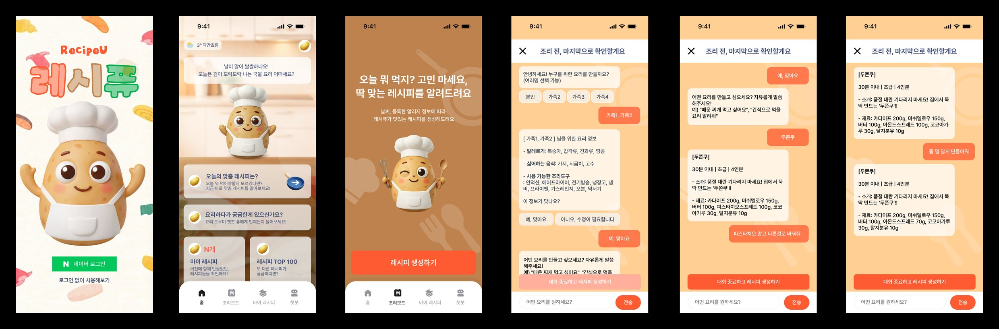
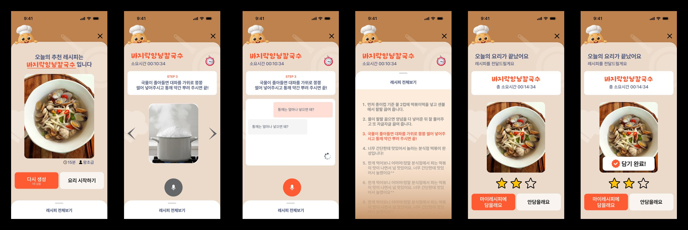
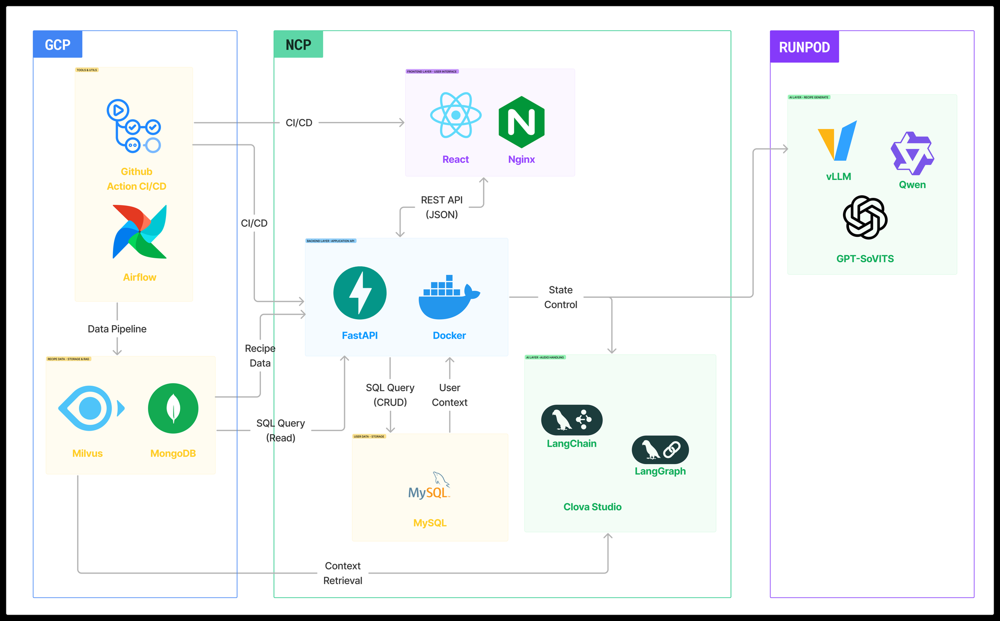
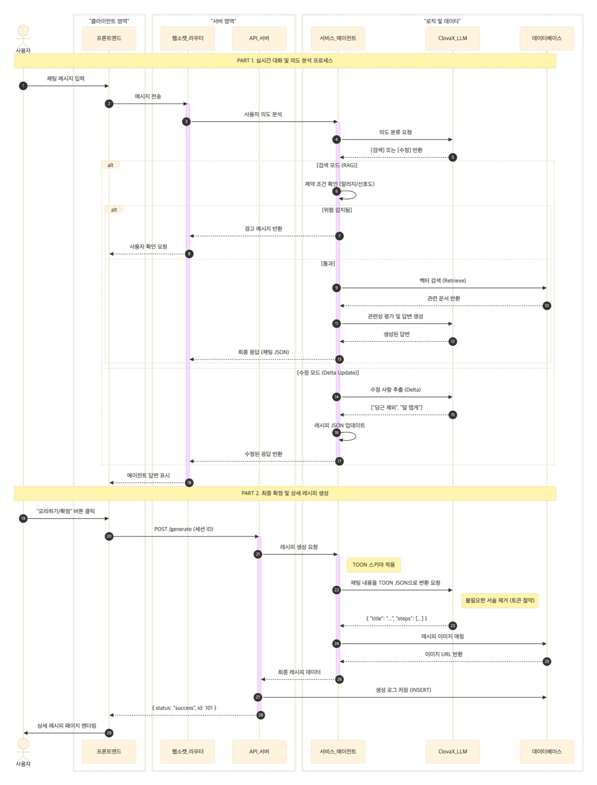
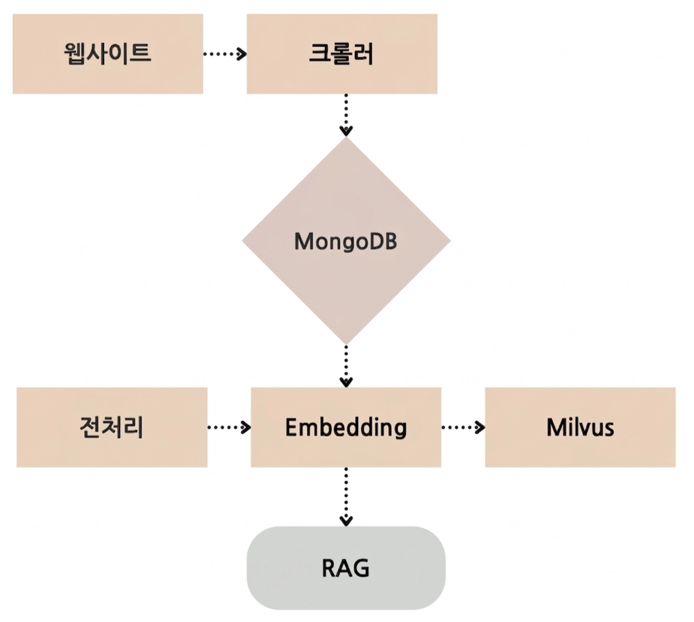
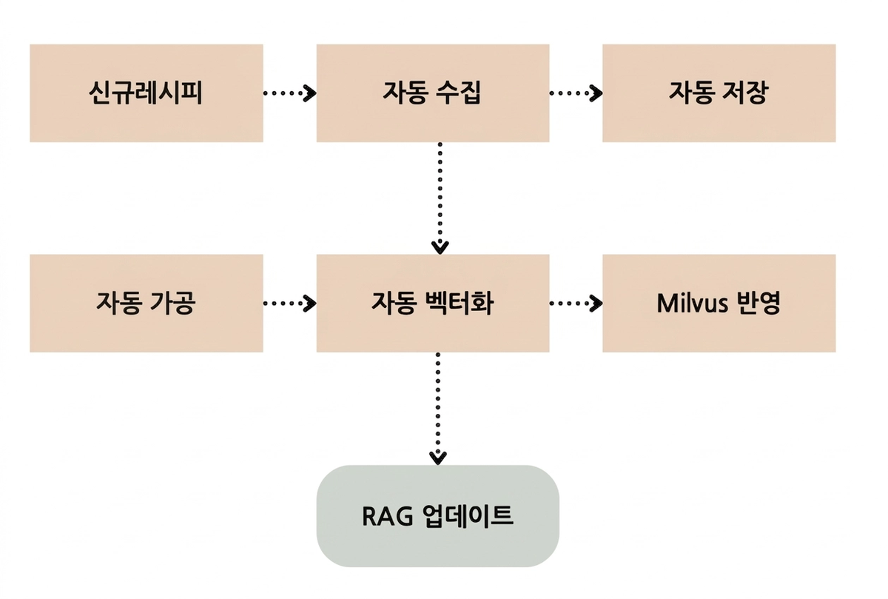

## 서비스 소개

RecipeU는 사용자의 알레르기·비선호 재료, 가지고 있는 조리도구, 그리고 "몸이 따뜻해지는 국물 요리" 같은 그때그때의 취향까지 반영하는 개인화 AI 요리 에이전트입니다.

기존 레시피 서비스는 키워드 검색으로 레시피를 한 번 보여 주고 끝나서, 내 상황에 맞게 고쳐 나갈 수 없었습니다. 요리하는 동안에도 젖은 손으로 화면을 넘겨야 했습니다. 그래서 RecipeU는 요리를 **대화로 레시피를 함께 완성하고, 음성으로 안내받는 경험**으로 바꿨습니다.

<video class="embed-video file" src="/assets/img/projects/recipeu/recipeu-demo.mp4" controls preload="metadata" playsinline aria-label="RecipeU 시연 영상"></video>
_시연 영상 (약 3분 40초): 레시피 생성 채팅부터 음성 조리 모드까지_

_가족의 알레르기·조리도구 정보를 확인하고, 대화로 레시피를 고쳐 나가는 화면_

_확정한 레시피로 요리 모드에 들어가 단계별 안내를 받고, 궁금한 점은 음성으로 묻는 화면_

서비스는 크게 **레시피 생성**과 **음성 요리 안내** 두 파트로 나뉩니다. 저는 이 중 **레시피 생성 파트**를 맡아, 레시피 데이터 구축부터 Agent, 성능 개선, 평가까지 진행했습니다. 음성 파이프라인(VAD → STT → LLM → TTS)과 GPU 모델 서빙은 다른 팀원들이 맡았습니다.

## 시스템 구성

서비스는 세 클라우드에 나눠 배포했습니다.

| 환경 | 역할 |
|---|---|
| GCP | 레시피 데이터 파이프라인(Airflow), 레시피 저장소(MongoDB)와 벡터 DB(Milvus), CI/CD |
| NCP | 프론트엔드(React + Nginx), 백엔드(FastAPI), 사용자 DB(MySQL), 레시피 Agent |
| RunPod | 음성 기능용 LLM(vLLM으로 Qwen 서빙)과 TTS(GPT-SoVITS) |

레시피 생성은 두 단계로 이뤄집니다. 대화 중에는 웹소켓으로 가볍게 검색·수정만 하고, 사용자가 확정 버튼을 누를 때만 API로 상세 레시피를 생성해 저장합니다. 이렇게 나눠 대화 응답 속도와 생성 비용을 함께 잡았습니다.

## 주요 기여

### 1. 레시피 데이터 구축

레시피 Agent가 근거로 삼을 데이터를 만들기 위해, 만개의레시피 사이트에서 **약 4만 개의 레시피**를 크롤링해 검색할 수 있는 형태로 가공했습니다.

{: w="520" }

- **수집과 저장**: 크롤링한 레시피를 JSON 그대로 MongoDB에 저장했습니다. 전처리 방식을 바꾸더라도 다시 크롤링하지 않고 원본에서 다시 가공할 수 있게 하려는 것입니다.
- **전처리**: 텍스트를 정제하고 문단 단위로 나눠 검색에 알맞은 형태로 바꿨습니다.
- **벡터화와 검색 DB**: 네이버가 API로 제공하는 **BGE-M3** 임베딩 모델로 벡터를 만들어 Milvus에 저장하고, 유사도 검색 환경을 구축했습니다.

### 2. Airflow로 수집·임베딩 자동화

처음에는 크롤링과 전처리를 손으로 실행해서 데이터 갱신 주기가 불규칙했고, '두쫀쿠'처럼 새로 유행하는 레시피가 반영되지 않았습니다. 이를 **Apache Airflow DAG**로 묶어, 신규 레시피 수집부터 Milvus 반영까지 전 과정이 주기적으로 자동 실행되도록 바꿨습니다.

{: w="620" }

MongoDB, Milvus, Airflow는 GCP 인스턴스(vCPU 4개, 메모리 16GB) 한 대에 각각 Docker 컨테이너로 올려, 의존성을 분리하고 실행 환경을 맞춰 운영했습니다.

### 3. 레시피 Agent 구축

LangGraph로 레시피 Agent를 구축했습니다. 사용자 입력은 먼저 **HCX-DASH가 4가지 의도로 분류**하고, 의도에 따라 다른 흐름으로 처리합니다.

| 의도 | 처리 |
|---|---|
| RECIPE_SEARCH | 질의 재작성 → Milvus 검색 → 제약 조건 필터링 → 관련성 평가 → HCX-003으로 레시피 생성 |
| RECIPE_MODIFY | 이전 대화와 최신 레시피를 조회해 변경 사항(Delta)만 추출하고 재료·단계에 반영 |
| COOKING_QUESTION | 요리 지식이나 팁에 대한 답변 생성 |
| NOT_COOKING | LLM을 호출하지 않고 외부 챗봇으로 안내 |

**Adaptive RAG.** 검색 품질을 높이기 위해 두 가지를 적용했습니다.

- **질의 재작성**: "더 매운 걸로"처럼 모호한 질문은 최근 5턴의 대화를 보고 "매운 김치찌개" 같은 검색어로 바꿉니다.
- **관련성 평가**: 검색 결과가 질문과 맞는지 제목 단어 매칭과 LLM 판정(yes/no)으로 확인하고, 맞지 않으면 웹 검색(Serper.dev)으로 자동 전환합니다. DB에 없는 레시피를 요청받아도 엉뚱한 레시피를 만들지 않게 하려는 것입니다.

**제약 조건 충돌 감지.** 사용자의 알레르기·비선호 재료·보유 조리도구를 프롬프트에 함께 넣고, 요청에 위험 재료가 있으면 생성 전에 경고합니다. 예를 들어 새우 알레르기가 있는 사용자가 "새우도 넣을까"라고 하면 수정을 막고 다른 재료를 권합니다.

**프롬프트 설계.** 출력 개수, 재료 형식, 인원 수, 알레르기 처리 같은 규칙과 함께 올바른 예시와 잘못된 예시(few-shot)를 넣어 톤과 형식을 일정하게 맞췄습니다. 개인정보나 욕설이 포함된 입력, 요리와 무관한 질문은 응답 전에 차단합니다.

### 4. 응답 시간과 토큰 최적화

레시피 생성 파트에서 가장 많이 고민한 부분입니다.

**Reranker 제거로 응답 시간 단축.** 파이프라인 노드별 실행 시간을 측정해 보니 Reranker 단계가 병목이었습니다. 조건 기반 1차 필터링 이후라 Top-K 검색만으로도 품질이 충분하다고 판단해 Reranker를 제거했고, 응답 시간이 약 1.5~2배 빨라졌습니다.

| 질문 | Reranker 사용 | Reranker 제거 |
|---|---|---|
| "두쫀쿠 먹고싶어" | 16.1초 | **8.1초** |
| "나 다이어트 중인데 달달한 거 먹고싶어" | 11.6초 | **5.4초** |
| "고등어쌈밥" | 8.9초 | **5.9초** |

**Delta 방식 수정.** LLM API는 이전 대화를 기억하지 않아서, 수정할 때마다 레시피 전체와 대화 기록을 다시 보내야 했고 수정이 반복될수록 토큰이 늘었습니다. 수정 호출에는 대화 기록 대신 최근 레시피와 현재 요청만 보내도록 바꿨습니다. 수정 요청은 `remove`, `replace`, `add`, `modify` 네 가지 유형의 변경 사항(Delta)으로 세션에 기록하고, 이후 레시피를 새로 생성하거나 검색할 때 제거·대체한 재료를 제약으로 반영해 앞서 뺀 재료가 다시 들어가지 않게 했습니다.

**의도 분류로 불필요한 호출 제거.** 처음에는 모든 입력이 RAG 파이프라인을 거쳐 요청마다 LLM을 3~5번 호출했습니다. 입력이 파이프라인에 들어가기 전에 대화 기록으로 레시피가 이미 있는지 확인하고, 4가지 의도로 분류해 필요한 흐름만 타도록 바꿨습니다.

| 의도 | 변경 전 | 의도 분류 적용 후 | 변화 |
|---|---|---|---|
| RECIPE_SEARCH | 1,789 tokens / 7.2초 | 1,903 tokens / 6.6초 | 토큰은 분류 단계만큼 늘고, 지연은 소폭 감소 |
| RECIPE_MODIFY | 1,701 tokens / 8.4초 | **714 tokens / 3.8초** | 토큰·지연 크게 감소 |
| COOKING_QUESTION | 3,020 tokens / 9.5초 | **944 tokens / 6.3초** | 토큰·지연 크게 감소 |
| NOT_COOKING | 지원 안 함 | 944 tokens / 6.3초 | 새로 지원 |

검색 요청은 의도 분류 단계가 더해져 토큰이 조금 늘었지만, 수정 요청과 요리 질문은 RAG를 거치지 않게 되면서 크게 줄었습니다.

**TOON 포맷 적용.** JSON은 키 이름이 반복돼 프롬프트가 길어졌고, 채팅은 매 턴 메인 LLM을 호출하기 때문에 프롬프트가 클수록 체감 속도가 느려졌습니다. JSON의 구조는 유지하면서 같은 정보를 더 짧게 표현하는 TOON 포맷으로 프롬프트와 응답을 통일했습니다.

| 요청 | JSON | TOON | 변화 |
|---|---|---|---|
| RECIPE_SEARCH | 1,903 tokens / 6.6초 | **1,315 tokens / 5.9초** | 토큰 감소, 지연 소폭 감소 |
| RECIPE_MODIFY | 714 tokens / 3.8초 | **615 tokens / 4.0초** | 토큰 감소, 지연은 비슷 |
| COOKING_QUESTION | 944 tokens / 6.3초 | **656 tokens / 5.3초** | 토큰·지연 감소 |
| RECIPE_GENERATION | 736 tokens / 14.3초 | **703 tokens / 8.8초** | 지연 크게 감소 |

특히 확정 버튼을 눌렀을 때의 상세 레시피 생성 시간이 14.3초에서 8.8초로 줄어, 사용자가 가장 오래 기다리던 구간이 크게 짧아졌습니다.

### 5. 시나리오 기반 Agent 평가

레시피 Agent가 실제 서비스에서 쓸 만한지 확인하려면, 질문 하나에 대한 답만 보는 것으로는 부족했습니다. 그래서 실제 사용 흐름을 따라가는 **시나리오 테스트**를 설계했습니다.

- **시나리오**: 질문 하나로 끝나는 싱글턴 시나리오 10개와, 대화가 이어지는 멀티턴 시나리오 10개를 만들었습니다.
- **평가 방식**: NAVER CLOVA의 HCX-007 모델에 평가 프롬프트를 주고 5점 만점으로 채점하게 했습니다.
- **평가 영역**: 대화 품질과, 대화에서 쌓인 조건을 반영한 최종 레시피의 완성도를 나눠 평가했습니다.

| 대화 품질 | 점수 | 레시피 생성 | 점수 |
|---|---|---|---|
| 제약 조건 인지 | **3.48** | 단계별 상세성 | **3.67** |
| 응답 속도·전달력 | 3.37 | 실현 가능성 | 3.53 |
| 정보 충실성 | 3.04 | 재료 충실성 | 3.27 |
| 대화 자연스러움 | 3.02 | 분량 정확성 | 3.20 |

대화에서는 제약 조건 인지가, 레시피에서는 단계별 상세성이 가장 높았습니다. 반면 대화 자연스러움과 레시피의 재료·분량 정확성은 상대적으로 낮아, 다음에 개선할 부분으로 정리했습니다.

### 6. 서버 인프라와 CI/CD

- **데이터 서버 (GCP)**: MongoDB, Milvus, Airflow를 Docker 컨테이너로 운영했습니다.
- **CI/CD (데이터 파이프라인)**: GitHub Actions로 푸시마다 DAG 문법을 검사하고, 변경된 경로에 따라 배포 방식을 나눴습니다. DAG만 바뀌면 Airflow 스케줄러·웹서버만 재시작하고, Dockerfile·docker-compose가 바뀌면 이미지를 다시 빌드해 컨테이너를 교체합니다. SSH 키와 서버 정보는 GitHub Secrets로 관리했습니다.

## 결과

웹 서비스로 배포해 대화형 레시피 생성과 음성 요리 안내까지 동작하는 상태로 마무리했습니다.

| 개선 | 결과 |
|---|---|
| 레시피 데이터 | 약 4만 개 수집, Airflow로 자동 갱신 |
| 레시피 응답 시간 | Reranker 제거로 약 1.5~2배 단축 |
| 수정 요청 처리 (실측) | 1,701 → 714 tokens, 8.4초 → 3.8초 (의도 분류로 검색 단계 생략) |
| 상세 레시피 생성 시간 | 14.3초 → 8.8초 (TOON 포맷) |
| Agent 평가 | 시나리오 20개, 대화·레시피 8개 항목 정량 평가 |

베타 테스트에서 13명에게 5점 척도로 물은 결과입니다. 레시피 생성 파트의 핵심인 **취향·알레르기 반영은 76.9%가 5점**을, 나머지는 모두 4점을 줬습니다.

  

    
레시피에 내 취향과 알레르기가 잘 반영되었나요?

    

      5점 76.9%
      4점 23.1%
    

  

  

    
오늘 날씨에 추천해 준 메뉴가 마음에 드셨나요?

    

      5점 61.5%
      4점 38.5%
    

  

  

    
정식으로 출시된다면 계속 사용하실 의향이 있나요?

    

      5점 61.5%
      4점 30.8%
      1
    

  

  
<i class="survey-seg s5"></i>5점<i class="survey-seg s4"></i>4점<i class="survey-seg s1"></i>1점

## 회고

레시피 생성 파트를 맡으며 가장 크게 배운 것은 **측정해야 고칠 수 있다**는 점입니다. 응답이 느리다는 것은 누구나 느꼈지만, 노드별 실행 시간을 재 보고 나서야 Reranker 한 단계가 병목이라는 것을 알았습니다. 토큰도 요청 유형별로 나눠 재 보니, 수정 요청에서 레시피 전체를 매번 보내는 구조가 문제라는 것이 드러났습니다.

데이터를 계속 살아 있게 만드는 일의 중요성도 느꼈습니다. RAG의 답변 품질은 결국 검색할 데이터에 달려 있는데, 한 번 모아 넣고 끝나면 데이터는 금방 낡습니다. Airflow로 수집부터 Milvus 반영까지 자동화하고 나서야 데이터가 서비스의 일부로 운영된다고 느꼈습니다.

아쉬운 점도 분명합니다.

- **평가 규모**: 개발 기간이 짧아 시나리오를 20개밖에 만들지 못했습니다. 실제 사용자는 훨씬 다양한 요청과 예외 상황을 만들기 때문에, 이 점수만으로 Agent 성능을 일반화하기는 어렵습니다.
- **평가 이후 개선**: 재료 충실성과 분량 정확성이 낮다는 것을 확인했지만, 일정상 고치는 데까지는 가지 못했습니다. 다음에는 평가 점수가 낮은 항목을 기준으로 프롬프트와 검색 전략을 반복해서 고치는 개선 루프까지 만들고 싶습니다.
- **규칙 기반 처리**: Delta 유형 분류처럼 키워드 규칙으로 처리한 부분이 남아 있어, 표현이 조금만 달라져도 놓칠 수 있습니다. 질의 재작성과 의도 분류를 작은 로컬 모델로 학습해 교체하는 방향을 생각하고 있습니다.
