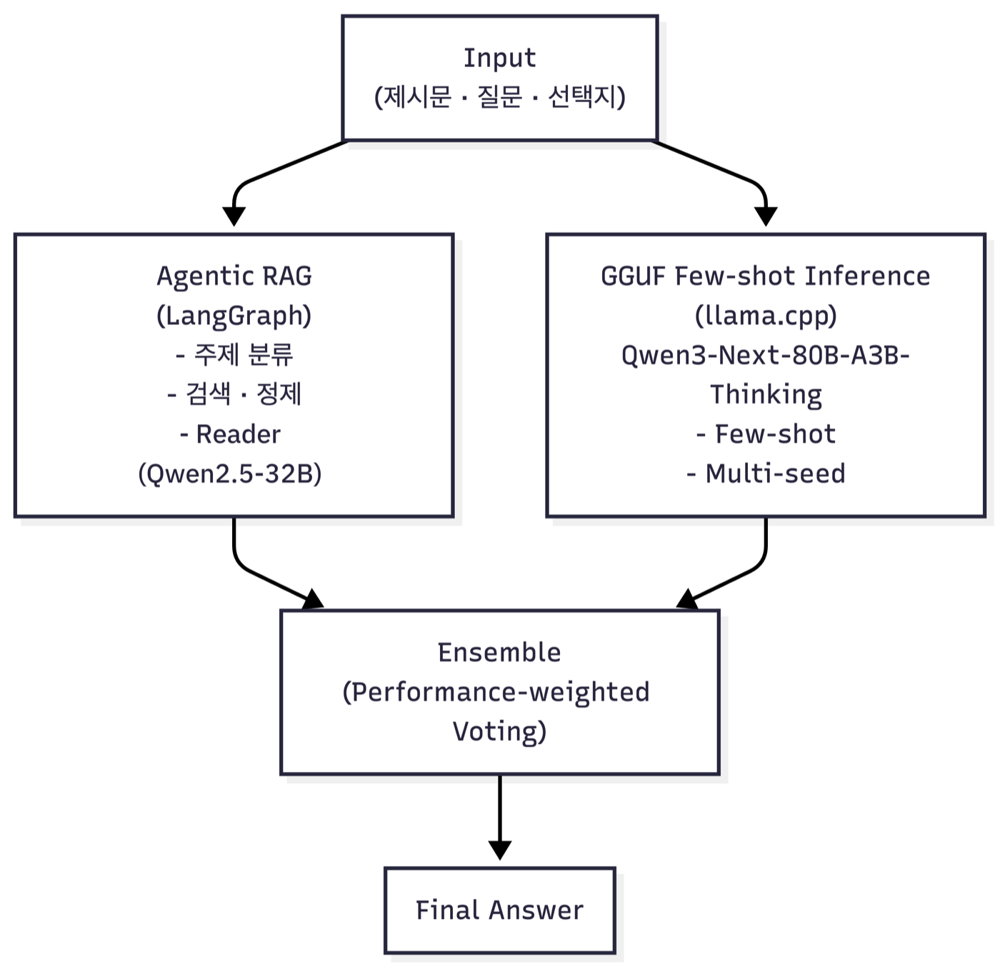
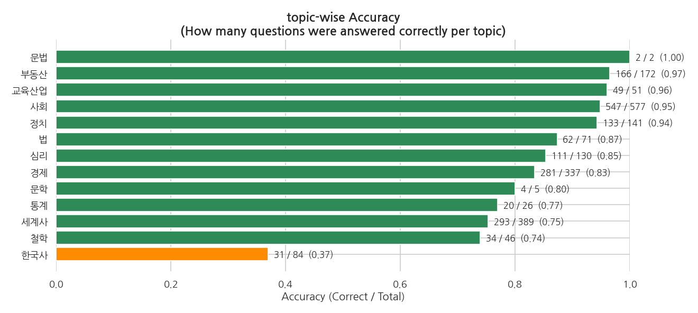

## 문제 정의

수능형 객관식 문제를 푸는 모델을 만드는 대회였습니다. 지문, 질문, 선택지를 입력받아 정답 번호(1~5)를 고르는 **다지선다 분류** 문제이고, 평가 지표는 Macro F1입니다.

순위는 리더보드로 매겼습니다. 대회 중에는 테스트 데이터 일부로 계산한 **public 점수**만 공개되고, 최종 순위는 나머지 데이터로 계산한 **private 점수**로 정해집니다.

GPT, Claude, Gemini 같은 대형 모델은 수능에서도 높은 점수를 받지만, 큰 파라미터와 연산 자원이 있어야 가능한 성능입니다. 그래서 **제한된 GPU(Tesla V100 32GB)에서 어디까지 끌어올릴 수 있는지**가 이 프로젝트의 질문이었습니다.

| 구분 | 내용 |
|---|---|
| 데이터 | train 2,031개 · test 869개 |
| 주제 | 사회·세계사·경제가 약 64%, 문학·문법은 0.35% |
| 정답 분포 | 1번 정답이 5번 정답의 약 18배 |
| 지문 길이 | 평균 537토큰, 최대 1,532토큰 |

정답 분포에 **클래스 불균형**이 심해서, 소수 클래스인 5번을 하나만 놓쳐도 해당 클래스의 F1이 0에 가까워지고 Macro F1이 크게 떨어집니다. 예측이 다수 클래스(1번)로 편향될 위험도 있어, Accuracy가 아닌 Macro F1 기준으로 판단해야 했습니다.

## 시스템 구성

최종 시스템은 여러 추론 결과를 앙상블로 합치는 구조입니다. 아래 그림은 그 흐름을 단순화한 것입니다.



- **Agentic RAG**: 외부 지식이 필요한 **한국사 문제에 적용**했습니다. LangGraph로 문제의 주제를 분류하고 BGE-M3 임베딩과 FAISS로 관련 문서를 검색한 뒤, Reader 모델(Qwen2.5-32B)이 검색 결과를 참고해 답을 고릅니다. 검색 결과의 유효성을 점수화해 임계값보다 낮으면 질의를 재작성해 다시 검색합니다.
- **GGUF few-shot 추론**: llama.cpp로 GGUF 양자화된 Qwen3-Next-80B-A3B-Thinking 모델을 서빙하고, 임베딩 유사도로 고른 학습 문제를 few-shot 예시로 넣어 multi-seed로 추론합니다.
- **앙상블**: 그동안 제출한 결과 중 리더보드 점수가 0.7 이상인 것들을 모아, 점수를 가중치로 한 **가중 다수결**로 최종 답을 정합니다. 제가 CPT로 학습한 모델의 추론 결과도 여기에 들어갔습니다.

학습 데이터는 팀원들이 부족한 주제(문학·문법, 화법과 작문, 한국사·정치·법)의 문제를 추가로 수집해 늘렸습니다. 원본 2,031개에서 4차까지 늘려 봤지만, 4차 증강본(7천여 개)보다 3차 증강본(4,067개)으로 학습했을 때 수렴이 더 안정적이고 성능도 높았습니다. 데이터를 더 늘리면 오히려 노이즈가 커진다고 보고 3차에서 멈췄습니다.

이 중 제가 맡은 부분은 **Qwen2.5-32B 모델의 학습과 추론**, 그리고 **RAG가 가져온 지식을 추론 모델의 입력으로 연결하는 부분**입니다.

## 주요 기여

### 32B 모델 학습 환경 구축

수능형 문제는 긴 지문을 읽고 추론해야 해서, 작은 모델로는 한계가 있다고 판단했습니다. 32GB GPU 한 장의 메모리 안에서 학습하기 위해 **Unsloth의 4-bit 양자화 모델**에 gradient checkpointing을 적용했고, 한국어 이해와 생성 성능이 좋다고 판단한 Qwen 계열 중 `Qwen2.5-32B-Instruct`를 골라 LoRA로 파인튜닝했습니다.

### 추론 방식: generate에서 logit으로

토큰을 하나씩 순서대로 생성하는 generate 방식에서는 정답 번호가 나오기 전에 생성이 조기 종료되는 일이 잦았고, 그 경우 출력에서 정답 번호를 추출하지 못했습니다.

그래서 문장을 생성하지 않고, 다음 토큰의 logit 중 **선택지 번호(1~5)의 값만 비교해 답을 고르는 logit 방식**으로 바꿨습니다. 답이 항상 선택지 번호 중 하나로 나와 생성이 끊길 일이 없습니다. 같은 모델을 같은 방식으로 파인튜닝하고 추론 방식만 비교했습니다.

핵심 부분만 줄이면 다음과 같습니다.

```python
outputs = model(inputs)
logits = outputs.logits[:, -1].flatten()  # 마지막 위치에서 다음 토큰의 분포

# 선택지 번호("1"~"5") 토큰의 logit만 꺼낸다 (선택지 수만큼)
target_logits = [logits[tokenizer.vocab[str(i + 1)]] for i in range(len_choices)]

# 선택지끼리만 softmax를 취해 가장 확률이 높은 번호를 정답으로 고른다
probs = torch.softmax(torch.tensor(target_logits, dtype=torch.float32), dim=-1)
answer = int(probs.argmax()) + 1
```

| 추론 방식 | public | private |
|---|---|---|
| generate | 0.6444 | 0.5759 |
| logit | 0.7501 | 0.6910 |

두 점수 모두 약 0.1 이상 올랐습니다.

### 주제별 성능 분석과 Continued Pre-Training

점수를 더 올리려면 모델이 어떤 문제에서 틀리는지 알아야 했습니다. 파인튜닝하지 않은 기본 모델로 학습 데이터 전체를 추론하고 **주제별 정확도**를 비교하는 오류 분석을 했습니다. 일반화 성능을 재려는 게 아니라 약점을 찾는 것이 목적이라 검증 데이터는 따로 나누지 않았습니다.



- 주제별 편차가 뚜렷했고, **한국사의 정확도가 약 0.37(31/84)로 가장 낮았습니다.**
- Qwen은 사전학습 데이터에서 중국어 비중이 큰 모델이라, 한국사처럼 특정 국가의 지식에 의존하는 영역에서 불리했을 가능성이 있다고 봤습니다. 다만 이 원인은 따로 검증하지 못했습니다.

틀리는 이유가 출력 형식이 아니라 **도메인 지식 부족**이라고 봤습니다. 정답을 출력하는 형식을 학습하는 LoRA 파인튜닝은 형식을 맞추는 데는 효과적이지만, 모델에 없는 지식을 채워 주지는 못합니다. 그래서 증강한 데이터의 내용 자체를 모델에 학습시키는 **Continued Pre-Training(CPT)** 으로 지식을 주입했습니다. 학습은 Unsloth가 제안한 Continued Pre-Training 방식을 따랐습니다. 기존 LoRA 학습이 정답을 출력하는 형식을 학습했다면, CPT에서는 지문·질문·선택지까지 문제 전체의 텍스트를 학습하도록 바꿨습니다.

| 설정 | 학습 내용 | public | private |
|---|---|---|---|
| LoRA 없이 추론 | 학습 없음 | 0.7488 | 0.7113 |
| 데이터 + LoRA | 정답 출력 형식 | 0.7501 | 0.6910 |
| 증강 데이터 + LoRA | 정답 출력 형식 | 0.7501 | 0.6910 |
| **증강 데이터 + CPT** | **문제 전체 텍스트** | **0.7962** | **0.7616** |

LoRA 파인튜닝은 효과가 없었습니다. public 점수는 LoRA 없이 추론한 것과 거의 같았고 private 점수는 오히려 조금 떨어졌으며, 증강 데이터를 써도 달라지지 않았습니다. 반면 CPT로 지식을 주입하자 LoRA 없이 추론한 것보다 private 점수가 **0.7113 → 0.7616**으로 올라, 지식 주입이 효과가 있었습니다.

### CoT 프롬프트 엔지니어링

logit 방식은 프롬프트 직후 한 토큰의 분포만 보고 답을 정하기 때문에, 답을 내기 전에 추론 과정을 생성할 여지가 없습니다. 추론 과정을 먼저 생성하게 하는 **CoT(Chain-of-Thought) 프롬프트**는 generate 방식에서만 쓸 수 있어서, CoT를 적용한 generate 방식이 logit 방식을 넘을 수 있는지 실험했습니다.

검증 데이터로 비교한 결과입니다.

| 방식 | Accuracy | Macro F1 | Weighted F1 |
|---|---|---|---|
| logit | **0.8720** | **0.8368** | **0.8711** |
| CoT + generate | 0.8440 | 0.6764 | 0.8504 |

결과는 **오히려 낮았습니다.** 특히 Accuracy는 약 0.03 떨어진 데 비해 Macro F1은 약 0.16이나 떨어졌습니다. 클래스별 F1을 같은 비중으로 평균하는 Macro F1만 크게 떨어졌다는 것은, 소수 클래스(정답 번호)에서 많이 틀렸다는 뜻으로 보입니다. 다만 CoT와 generate 방식이 함께 바뀐 비교라 CoT만의 효과로 보기는 어렵고, 시간이 부족해 원인을 더 분석하지는 못했습니다.

### RAG와 추론 모델 통합

한국사처럼 모델이 가진 지식만으로는 풀기 어려운 문제를 위해, **RAG로 가져온 참고 지식을 모델이 추론에 쓸 수 있도록** 연결했습니다. 팀원이 만든 Agentic RAG가 문제에 맞는 지식을 검색해 오면, 그 내용을 입력에 함께 넣어 Reader 모델이 답을 고르는 흐름입니다.

## 결과

최종 리더보드 **2위**(private Macro F1 **0.8015**)입니다. 대회 중 공개된 public 리더보드에서는 4위였고, 최종 평가인 private에서 2위로 올랐습니다. 아래는 단계별 private 점수입니다.

| 단계 | private Macro F1 | 담당 |
|---|---|---|
| Qwen2.5-32B + LoRA (generate) | 0.5759 | 직접 |
| 추론 방식을 logit으로 변경 | 0.6910 | 직접 |
| 증강 데이터로 CPT | 0.7616 | 직접 (데이터는 팀) |
| 여러 제출 결과를 가중 투표로 앙상블 | **0.8015** | 팀 |

CPT 단계에는 팀원이 만든 증강 데이터가 쓰였고, 마지막 앙상블은 제 CPT 모델의 결과를 포함해 팀원들이 만든 여러 제출 결과를 합쳐서 얻은 점수입니다.

## 회고

이 과제에서 점수를 크게 올린 것은 추론 방식과 학습 방식 같은 **기본 설계**였습니다. 추론을 generate에서 logit으로 바꾼 것(0.58 → 0.69), 지식이 부족한 영역을 CPT로 채운 것(LoRA 없이 추론한 0.71 → 0.76)이 차례로 점수를 끌어올렸습니다. 어디서 틀리는지를 먼저 분석하고, 그 원인에 맞는 방법을 골랐을 때 효과가 컸습니다.

모델이 틀리는 이유가 출력 형식인지 도메인 지식인지에 따라 필요한 학습이 다르다는 것도 직접 확인했습니다. 정답 출력 형식을 학습하는 LoRA 파인튜닝은 지식을 채워 주지 못했고, 문제 전체 텍스트를 학습하는 CPT로 지식을 주입하자 효과가 있었습니다.

아쉬운 점도 분명합니다.

- **CoT 실험**: Macro F1이 크게 떨어진 원인을 클래스별로 나눠 확인하지 못했습니다. 다음에는 CoT로 추론 과정을 생성한 뒤 그 끝에서 logit으로 답을 고르는 방식처럼, CoT의 추론과 logit 방식의 안정성을 함께 쓰는 방법을 시도해 보고 싶습니다.
- **실험 관리**: Weights & Biases 같은 도구를 충분히 쓰지 못해, 설정과 하이퍼파라미터가 바뀐 과정을 체계적으로 기록하고 비교하지 못했습니다. 일부 결과는 더 정밀하게 분석하지 못했습니다.
- **한국사 취약 원인**: 사전학습 데이터의 언어·지역 편향 때문이라고 추정했지만 따로 검증하지는 못했습니다.
